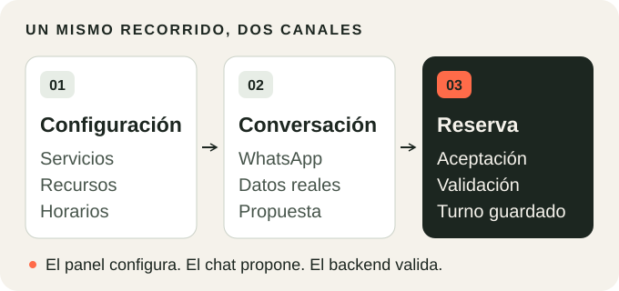

<picture>
  <source media="(prefers-color-scheme: dark)" srcset="apps/web/public/brand/logo-inverse-outlined.svg">
  
</picture>

# De la conversación al turno

**Atención por WhatsApp, con la agenda del negocio como fuente de verdad.**

Coordinar turnos por chat exige responder consultas, cruzar horarios y registrar lo acordado. agendIA reúne un panel de gestión y un agente de IA: el negocio define qué ofrece y cuándo atiende; el agente consulta esos datos y ayuda a reservar, cambiar o cancelar turnos.

[Entender el producto](docs/understanding.md) · [Documentación](docs/README.md) · [Desarrollo local](docs/DEVELOPMENT.md) · [Operaciones](docs/OPERATIONS.md)

## Un negocio, dos formas de operar su agenda

- **Desde el panel:** gestionar perfil, servicios, recursos, horarios y cierres, clientes y turnos; configurar el agente y vincular WhatsApp.
- **Desde la conversación:** consultar información y disponibilidad, preparar propuestas y operar los turnos propios del cliente mediante herramientas de agenda.
- **Desde administración:** resolver solicitudes de acceso, suspender o reactivar negocios, consultar el estado de WhatsApp y gestionar la baja.

> **Una propuesta no es una reserva.** Consultar un horario no lo bloquea. El guardado vuelve a validar condiciones y disponibilidad; la conversación necesita la aceptación de la propuesta entregada.

## Empezá por una pregunta

**¿Qué representa cada cosa?** Leé [el modelo del producto](docs/understanding.md): negocio, servicio, recurso, cliente y turno, con un ejemplo y los límites del agente.

**¿Cómo llega el chat a una reserva?** Seguí [el recorrido de una reserva](docs/booking-journey.md): propuesta, entrega, aceptación, guardado y confirmación.

**¿Cómo está construido?** Seguí [Arquitectura](docs/ARCHITECTURE.md) y [Base de datos](docs/DATABASE.md). El sistema separa panel, API, procesamiento de IA y conexión con WhatsApp; los datos de cada negocio se aíslan con `business_id` y RLS en PostgreSQL.

**¿Cómo contribuyo?** Prepará el entorno con [Desarrollo](docs/DEVELOPMENT.md), usando Bun 1.4.0 y Docker. Ahí están el arranque del panel y los workers, las variables y [las suites de pruebas](docs/DEVELOPMENT.md#tests). Para desplegar, consultá [Operaciones](docs/OPERATIONS.md).

## Ubicate en el repositorio

- [`apps/web`](apps/web) — panel de negocio y administración, con Next.js.
- [`apps/api`](apps/api) — API HTTP con Fastify, sesiones y operaciones del panel.
- [`apps/message-worker`](apps/message-worker) — agente de IA y resúmenes de conversación.
- [`apps/whatsapp-manager`](apps/whatsapp-manager) — sesiones de WhatsApp, recepción y envío con Baileys.
- [`packages`](packages) — dominio, persistencia, contratos, autenticación y adaptadores de proveedores.

**Base técnica:** Bun · TypeScript · Next.js · Fastify · PostgreSQL · Drizzle + SQL · pg-boss · DeepSeek · Baileys.

La [guía de documentación](docs/README.md) conecta las explicaciones con el código y el [diccionario de tablas](docs/database/tables.md).

---

### Herramientas de desarrollo

[Desarrollado con Gentle Shell](https://github.com/Gentleman-Programming/gentle-shell). Atribución a las herramientas utilizadas; no implica certificación ni respaldo de sus autores.
