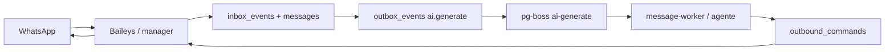

# Arquitectura

agendIA es un SaaS multi-negocio: cada negocio tiene un agente de IA que atiende por WhatsApp y agenda turnos. Hay dos roles: `business_user` (un usuario por negocio) y `platform_admin` (sin negocio, administra la plataforma).

## Componentes

| Componente | Responsabilidad | Proceso |
| --- | --- | --- |
| `apps/web` | Panel Next.js 16 (App Router). Sirve UI y reescribe `/api/*` hacia la API. | Puerto **3000**. |
| `apps/api` | API Fastify 5: sesión, CSRF, rutas de negocio y administración. | Puerto **3001**. |
| `apps/message-worker` | Consume `ai-generate` y `conversation-summary`; ejecuta el agente y el resumen. | Sin puerto. |
| `apps/whatsapp-manager` | Mantiene sockets Baileys, ingesta mensajes, publica la cola de IA y envía respuestas. | Sin puerto. |
| `packages/db` | Migraciones SQL, roles, unit of work, repositorios y colas. | Librería. |
| `packages/domain` | Reglas puras de agenda, disponibilidad, catálogo y agente. | Librería. |
| `packages/contracts` | Esquemas Zod compartidos entre API y web. | Librería. |
| `packages/auth` | Argon2id, sesiones, CSRF y cookie. | Librería. |
| `packages/ai-deepseek` | Adaptador de DeepSeek. | Librería. |
| `packages/whatsapp-baileys` | Gateway de Baileys y almacenamiento cifrado. | Librería. |

## Flujo HTTP

1. El navegador entra al panel en `:3000`. La portada (`/`) y `/login` consultan `/auth/session` y, con una sesión vigente, redirigen al panel del rol (`/profile` o `/businesses`); sólo muestran el ingreso cuando no hay sesión válida. `/admin/login` mantiene siempre su formulario para iniciar una sesión de administración. Next reescribe `/api/:path*` a `AGENDIA_API_ORIGIN`; el cliente web siempre usa rutas relativas `/api`.
2. El ingreso común usa `/auth/login`; el acceso de administración usa `/auth/admin/login`. La API rechaza administradores en el ingreso común. Valida el origen contra `APP_ORIGIN` y la cookie `__Host-agendia_session`. Las mutaciones además exigen `x-csrf-token`. El registro público requiere origen, pero no sesión. `/auth/session` incluye `sessionId`, un identificador no utilizable como credencial que permite detectar el reemplazo de una sesión.
3. `requireTenant` exige `business_user` con `business_id`; `requireAdmin` exige `platform_admin`. Un rol equivocado recibe 403 o 404, no un recurso ajeno.
4. Cada escritura corre en `TenantUnitOfWork`: `SET LOCAL ROLE`, `set_config('app.tenant_id', …)` y la operación de dominio. El evento de auditoría y el de outbox se insertan en la misma transacción.

## Flujo de un mensaje de WhatsApp

1. Baileys recibe el evento y `PostgresInboundHandler` resuelve la conexión; solo procesa si está `CONNECTED`. Deduplica en `inbox_events`, hace upsert de `conversations` e inserta `messages`.
2. La ingesta inserta `outbox_events` con tópico `ai.generate` y clave estable `ai:<providerId>`. Los mensajes viejos de la misma conversación se marcan como superados.
3. `AiOutboxDispatcher` reclama filas con `claim_ai_outbox` (token, TTL 30 s, lote 20) y publica en la cola `ai-generate` con `singletonKey` y `retryLimit: 2`. Si falla, `release_ai_outbox` reintenta con backoff hasta 60 s.
4. `message-worker` consume `ai-generate` con un lock asesor por conversación. Puede programar antes un `conversation-summary` (`retryLimit: 5`) y luego ejecuta el agente, que usa herramientas de agenda para leer catálogo/disponibilidad y escribir turnos.
5. El resultado se persiste como `outbound_commands` en estado `generated`, o como `messages.processing_state = silent_completed` si el agente decide no responder. Un fallo del proveedor marca `ai_failed`.
6. El manager reclama los `generated` con `claim_owned_outbound`, envía por Baileys y cierra en `sent`, `failed` o `delivery_unknown`.

## Aislamiento y seguridad

- Toda tabla de negocio lleva `business_id`; las relaciones usan claves foráneas compuestas `(business_id, id)` para que un cruce entre negocios sea imposible a nivel SQL.
- 26 tablas tienen `ENABLE` + `FORCE ROW LEVEL SECURITY`. Las globales incluyen `businesses`, `auth_identities`, `web_sessions`, `operational_controls`, los throttles de login y las tablas de registro.
- Hay cuatro roles de capacidad: `agendia_runtime`, `agendia_admin_runtime`, `agendia_whatsapp_runtime` y `agendia_worker_runtime`. El login de conexión solo tiene membresía; cada transacción activa el rol y los settings `app.tenant_id`, `app.actor_role`, `app.actor_id` y `app.request_id`.
- Las credenciales de WhatsApp se cifran con AES-256-GCM. `BAILEYS_KMS_KEY` y `WHATSAPP_LINK_CODE_KEY` deben ser base64 de exactamente 32 bytes y se validan al arrancar.
- La sesión es un token opaco de 32 bytes; se guarda su SHA-256. Sin «Mantener sesión iniciada», el negocio dura hasta 7 días (2 días de inactividad) y administración 8 h (30 min de inactividad); la cookie termina con el navegador. Con la casilla, el negocio dura hasta 6 meses calendario (30 días de inactividad) y administración 7 días (1 día de inactividad); la cookie persistente nunca supera el límite absoluto. Solo la interacción humana en el panel renueva la inactividad mediante `POST /auth/activity`, protegido por origen y CSRF; consultas, sondeos y bootstrap de CSRF no la renuevan. El login tiene throttle global y por cuenta.
- El bootstrap permite un único `platform_admin` a través de la aplicación; la tabla no impone esa unicidad.

## Decisiones y por qué

- **Cuatro procesos, no un monolito.** Los sockets de WhatsApp son stateful y fallan distinto que la API; separarlos aísla fallas y permite escalar la API sin duplicar sesiones.
- **Migraciones SQL como autoridad.** El modelo incluye RLS, funciones `SECURITY DEFINER`, triggers y exclusiones GiST que Drizzle no expresa. `packages/db/src/schema.ts` declara solo 3 tablas y no es el modelo.
- **Outbox transaccional.** La mutación, la auditoría y el trabajo pendiente se confirman juntos; publicar la cola es un paso reintentable, no una pérdida posible.
- **pg-boss sobre PostgreSQL.** Evita un servicio extra de colas y reutiliza la misma base con el esquema `pgboss`.
- **Idempotencia explícita.** Las operaciones de turno aceptan `x-appointment-operation-key` y se registran en `appointment_operation_receipts` para que un reintento no duplique.
- **Adaptadores aislados.** DeepSeek y Baileys viven en paquetes propios; el dominio depende de interfaces, no de proveedores.

## Baja de negocios

La API administrativa ejecuta la purga, auditoría y marca irreversible en una sola transacción. Los disparadores de escritura bloquean la fila del negocio hasta terminar cada transacción y rechazan nuevas escrituras tras la baja. Los trabajos de IA ya publicados encuentran ausentes sus mensajes de origen; no se purgan los jobs de `pgboss`.

El manager actual vuelve a admitir cada envío bajo el lock del negocio antes de invocar el gateway; no espera la entrega bajo ese lock. El gateway de producción puede recorrer varios adaptadores de forma asíncrona, por lo que la admisión aún no demuestra que la llamada al proveedor ya haya comenzado. Un manager antiguo tampoco tiene la segunda comprobación. No se cierran ni drenan todos los sockets antiguos. La auditoría histórica y las copias anteriores pueden conservar datos.

## Límites conocidos

- No hay automatización de backup/restore en el repositorio.
- El negocio se registra sin verificación de correo y queda pendiente sin poder iniciar sesión hasta que administración apruebe. Rechazar libera el correo; administración no crea negocios manualmente ni cambia su nombre o contraseña, pero conserva la suspensión y reactivación. La baja elimina los datos activos y conserva el historial de auditoría.
- La vinculación y revinculación de WhatsApp se hacen desde el panel; el manager reconecta solo cuando la sesión sigue siendo válida.
- No hay API pública para terceros; los contratos son internos entre API y web.

## Para profundizar

- Modelo de datos y roles: [DATABASE.md](DATABASE.md).
- Setup y pruebas: [DEVELOPMENT.md](DEVELOPMENT.md).
- Despliegue y runbook: [OPERATIONS.md](OPERATIONS.md).
