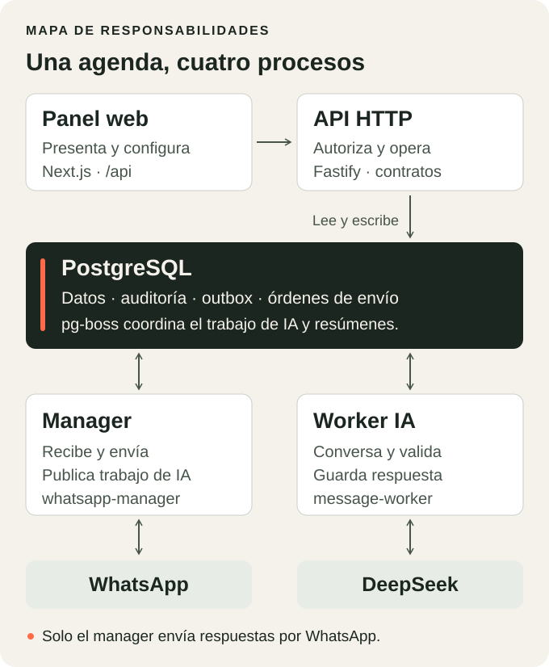

[agendIA](../README.md) / [Documentación](README.md) / Arquitectura

# Arquitectura

**Cuatro procesos conectan el panel y WhatsApp con una misma agenda en PostgreSQL.** La web presenta; la API autoriza las operaciones del panel; el worker conversa y usa herramientas; el manager mantiene WhatsApp y entrega mensajes. Ningún texto del modelo sustituye una escritura confirmada.

Antes de recorrer carpetas, seguí [una reserva de principio a fin](booking-journey.md). Acá está el mapa para decidir dónde cambiar el sistema sin cruzar sus fronteras.

[Componentes](#componentes) · [HTTP](#flujo-http) · [WhatsApp](#flujo-de-un-mensaje-de-whatsapp) · [Seguridad](#aislamiento-y-seguridad) · [Baja](#baja-de-negocios)

## Componentes

### Los procesos

| Dónde empezar | Responsabilidad | No le corresponde |
| --- | --- | --- |
| [`apps/web`](../apps/web) · Next.js | Panel de negocio y administración; reescribe `/api/*` a la API. | Autorizar datos por ocultar botones. |
| [`apps/api`](../apps/api/src/app.ts) · Fastify | Sesión, CSRF, contratos HTTP y operaciones de negocio o administración. | Mantener sockets de WhatsApp. |
| [`apps/message-worker`](../apps/message-worker/src/index.ts) | Consume `ai-generate` y `conversation-summary`; ejecuta agente y resúmenes con DeepSeek. | Enviar respuestas al canal. |
| [`apps/whatsapp-manager`](../apps/whatsapp-manager/src/index.ts) | Vincula y restaura sesiones Baileys; ingesta, publica trabajo y despacha salidas. | Decidir por su cuenta las reglas de agenda. |

API y web tienen puertos HTTP; los otros dos procesos trabajan con colas y conexiones persistentes. Los valores de arranque y la topología están en [Desarrollo](DEVELOPMENT.md) y [Operaciones](OPERATIONS.md), no en este mapa de responsabilidades.

### Las piezas compartidas

- **Reglas:** [`packages/domain`](../packages/domain/src) contiene políticas de disponibilidad, cambios, estados y conversación; no llama a proveedores.
- **Persistencia:** [`packages/db`](../packages/db/src) reúne roles transaccionales, repositorios y unit of work. Las [migraciones SQL](../packages/db/migrations) completan las garantías que no viven en TypeScript.
- **Interfaces y acceso:** [`contracts`](../packages/contracts/src) comparte esquemas Zod entre web y API; [`auth`](../packages/auth/src) aporta contraseñas, tokens, cookie y protección de mutaciones.
- **Proveedores:** [`ai-deepseek`](../packages/ai-deepseek) y [`whatsapp-baileys`](../packages/whatsapp-baileys) adaptan IA y canal; este último cifra las credenciales persistidas.

## Flujo HTTP

1. **Panel → API.** El cliente web usa rutas relativas `/api`. El [rewrite de Next](../apps/web/next.config.ts) las dirige a `AGENDIA_API_ORIGIN` si está configurado; no es una API pública para terceros.
2. **Sesión y rol.** El ingreso común usa `/auth/login`; administración usa `/auth/admin/login`. La [autorización de rutas](../apps/api/src/app.ts) distingue `business_user` con negocio de `platform_admin` sin negocio. El registro público crea una solicitud pendiente, no acceso inmediato: [aprobarla](../apps/api/src/routes/administration.ts) crea negocio e identidad, rechazarla libera el correo. No hay verificación de correo.
3. **Protección de mutaciones.** La [capa HTTP](../apps/api/src/auth/http-auth.ts) comprueba sesión, origen esperado y `x-csrf-token`. La cookie `__Host-agendia_session` es segura y HttpOnly; la base guarda hashes, no el token de sesión original.
4. **Operación transaccional.** `RolePool.run` activa un rol y contexto local. Las escrituras de negocio canalizadas por [`TenantUnitOfWork`](../packages/db/src/unit-of-work.ts) confirman mutación, auditoría y outbox juntas. Las operaciones especiales, como registro y baja, tienen sus propias transacciones acotadas.

Las rutas de turnos revalidan disponibilidad y condiciones esperadas antes de guardar. `x-appointment-operation-key` permite registrar el resultado por negocio, actor y clave; repetir la misma operación devuelve el comprobante, no otro turno. Reutilizar la clave con otro contenido produce conflicto. Cancelar una **solicitud de operación** no equivale a cancelar un **turno**.

Las sesiones tienen vencimiento absoluto y por inactividad; «Mantener sesión iniciada» cambia sus plazos. Solo la actividad humana explícita del panel renueva la inactividad mediante `POST /auth/activity`, con origen y CSRF; el polling no la mantiene viva. El login tiene presupuestos global y por cuenta. Ver [rutas de autenticación](../apps/api/src/routes/auth.ts) y [repositorio de identidad](../packages/db/src/repositories/identity.ts).

## Flujo de un mensaje de WhatsApp

### Recibir y programar

La [ingesta](../apps/whatsapp-manager/src/inbound.ts) resuelve una sesión conectada, clasifica el evento y deduplica con `inbox_events`. Los grupos y contenidos no textuales no se convierten en pedidos al agente. Para texto individual aceptado guarda conversación, mensaje y evidencia de remitente cuando es válida.

El [repositorio de mensajería](../packages/db/src/repositories/messaging.ts) calcula cuándo responder según la política de ritmo. En la misma transacción inserta `outbox_events` con tópico `ai.generate` y clave estable `ai:<providerId>`. Una entrada nueva puede superar trabajo anterior; una respuesta manual del negocio se registra sin generar otra llamada a la IA. Los ecos identificados de salidas propias no se confunden con respuestas manuales.

[`AiOutboxDispatcher`](../apps/whatsapp-manager/src/ai-outbox.ts) reclama trabajo pendiente con token y vencimiento, publica en pg-boss (`ai-generate`) y marca la publicación. Si falla, libera el reclamo con backoff. El outbox conserva intención durable; no garantiza que todo trabajo termine procesado ni que un mensaje llegue al cliente.

### Conversar y guardar

El [procesador de IA](../apps/message-worker/src/jobs/ai-job.ts) serializa por conversación con un lock asesor y omite fuentes que ya no son vigentes. Puede programar un resumen, separado de la respuesta. El agente recibe contexto acotado y ejecuta [herramientas tipadas](../apps/message-worker/src/agent/tools.ts), no SQL libre.

El [adaptador de agenda](../apps/message-worker/src/agent/adapters/agenda.ts) mantiene la transacción mientras conversa con el proveedor: bloquea fuente, diálogo y calendario, valida remitente y usa los repositorios. Esto preserva atomicidad, pero mantiene locks durante llamadas externas; el runtime [acota rondas y tiempo](../apps/message-worker/src/agent/runtime.ts).

Para reservar o reprogramar distingue propuesta, entrega, aceptación, efecto provisional y commit. La salida válida se guarda como `outbound_commands.generated` junto con los efectos; una finalización silenciosa válida deja `silent_completed`, sin envío ni trabajo de agenda oculto. Un error de infraestructura revierte la sesión. El [recorrido de reserva](booking-journey.md) explica estas fronteras sin confundirlas con entrega.

### Entregar por el canal

El [dispatcher de salida](../apps/whatsapp-manager/src/outbound.ts) reclama solo órdenes elegibles de conexiones que posee, respetando vigencia y ritmo. Antes de invocar el gateway comprueba que el negocio siga activo. Registra `sent` con ACK, `failed` ante rechazo o `delivery_unknown` ante incertidumbre; [el repositorio](../packages/db/src/repositories/messaging.ts) verifica el token de propiedad al cerrar el envío.

**Persistido no significa enviado ni leído.** No hay transacción distribuida con WhatsApp ni promesa de entrega exactamente una vez. El fallo del último envío no revierte un turno ya confirmado.

## Aislamiento y seguridad

El negocio es el límite de datos, no el proceso que atendió la petición.

- **Aplicación:** sesión y rol autorizan la ruta; en WhatsApp, el remitente verificado limita los turnos que puede operar. Un teléfono escrito en el chat o un ID no prueban titularidad.
- **Transacción:** [`RolePool`](../packages/db/src/runtime-pools.ts) usa `SET LOCAL ROLE` y settings `app.tenant_id`, `app.actor_role`, `app.actor_id`, `app.request_id`. El contexto no queda como estado global reutilizable del pool.
- **PostgreSQL:** RLS forzada, ACL y claves compuestas protegen las tablas de negocio; las tablas globales usan permisos y funciones específicos. No todas las relaciones son compuestas: hay [excepciones explícitas](DATABASE.md#relaciones).
- **Secretos:** Argon2id para contraseñas, SHA-256 para sesión/CSRF y AES-256-GCM para credenciales de WhatsApp. Mensajes, resúmenes y auditoría no están cifrados por la aplicación. RLS no protege frente a superusuarios.

Los cuatro roles runtime tienen capacidades distintas; administración no recibe acceso general a conversaciones o credenciales. El bootstrap limita a un `platform_admin` mediante lock y comprobación de aplicación, no por unicidad SQL. Los detalles y excepciones están en [Base de datos](DATABASE.md#aislamiento-y-roles).

## Decisiones y por qué

**Separar fallas sin añadir otra base.** API, sockets y generación fallan distinto. PostgreSQL reúne datos y pg-boss, pero el esquema de colas es administrado por la biblioteca. Los procesos no comparten memoria como autoridad.

**Reglas en más de una frontera.** El dominio expresa políticas; repositorios validan estado actual y serializan agenda; SQL impone relaciones y capacidad. Una exclusión evita superposición, no demuestra consentimiento. Un prompt orienta al agente, no concede permisos.

**Intención durable antes de efectos externos.** Outbox, comprobantes y tokens de propiedad permiten reintentar o descartar trabajo obsoleto sin tratar la red como parte del commit. La idempotencia es específica de cada protocolo, no una garantía universal de «exactamente una vez».

## Baja de negocios

**Suspender no es eliminar.** La [baja administrativa](../apps/api/src/routes/administration.ts) llama a `delete_business`, definida en [0007](../packages/db/migrations/0007_private_business_purge.sql), con sesión vigente de administración. En una transacción bloquea el negocio, purga datos activos, conserva auditoría y agrega el evento de baja. Retiene `businesses` suspendido con `deleted_at` irreversible y lo oculta de la lista administrativa; el correo vuelve a estar disponible.

Los triggers serializan inserciones y actualizaciones contra ese bloqueo y rechazan escrituras posteriores, incluso de procesos viejos. Una identidad referenciada por un comprobante de otro negocio puede quedar inactiva y anonimizada, sin sesiones ni contraseña utilizable. La primitiva privada de purga no es una interfaz operativa.

**Límite externo:** los jobs publicados en `pgboss` no se purgan; sus procesadores encuentran el origen ausente. El manager actual vuelve a admitir un envío bajo el lock del negocio antes de invocar el gateway, pero el [gateway compuesto](../apps/whatsapp-manager/src/index.ts#L140-L148) puede esperar entre adaptadores: eso no prueba que toda llamada al proveedor empezó antes de la baja. Un manager antiguo puede carecer de esa segunda admisión. No se cierran ni drenan todos los sockets antiguos; auditoría, copias previas y mensajes entregados pueden conservar datos.

La [prueba de baja](../tests/integration/business-deletion-purge.integration.test.ts) cubre purga, aislamiento, rollback y escritores/envíos concurrentes; no demuestra el drenaje de todo proveedor externo.

## Límites conocidos

- El consentimiento natural y el cumplimiento de instrucciones dependen de interpretación del modelo; las referencias validan procedencia y contexto, no significado.
- Vincular o revincular WhatsApp requiere el panel; una reconexión automática depende de una sesión todavía válida.
- No hay API pública de terceros ni automatización de backup/restore en este árbol. Las copias y el despliegue son responsabilidades operativas separadas.

## Para profundizar

**Continuá → [Base de datos](DATABASE.md)** para relaciones y garantías de almacenamiento. Para cambiar comportamiento, empezá por el [recorrido y sus pruebas](booking-journey.md#para-seguirlo-en-el-código); para ejecutar el proyecto, [Desarrollo](DEVELOPMENT.md) y [Operaciones](OPERATIONS.md). [Volver al mapa](README.md).
