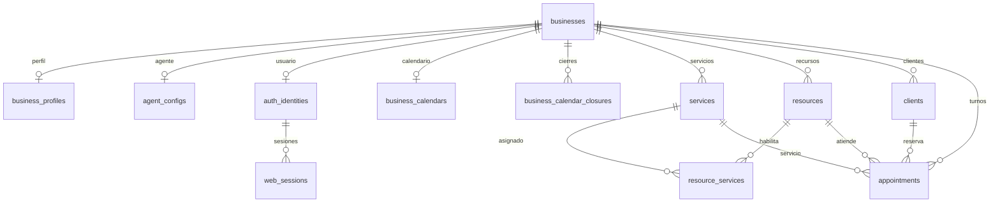
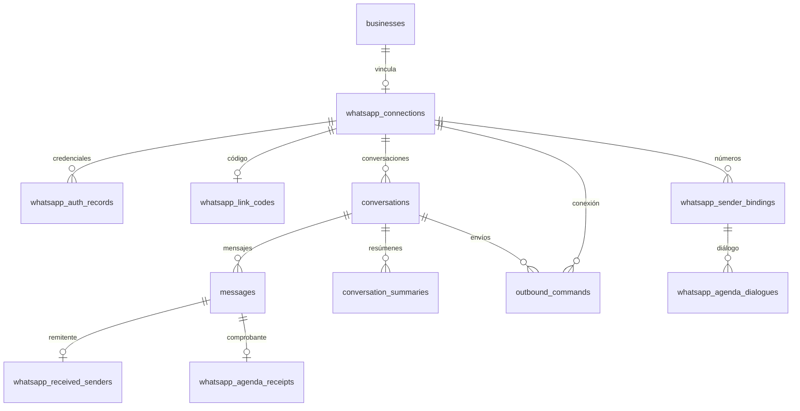

# Base de datos

agendIA usa PostgreSQL 16. Las migraciones SQL son la autoridad del modelo: `packages/db/migrations/` define tablas, roles, políticas RLS, funciones y disparadores. [`schema.ts`](../packages/db/src/schema.ts) declara solo 3 tablas y no es el inventario completo.

Esta guía describe el repositorio; no inspecciona una base en ejecución ni confirma qué migraciones se aplicaron en un servidor.

## Cómo leer

- Vista general y aislamiento: este documento.
- Cada tabla, su propósito y sus relaciones: [database/tables.md](database/tables.md).
- DDL exacto, restricciones y políticas: [`packages/db/migrations/`](../packages/db/migrations/), incluida [`0004_registration.sql`](../packages/db/migrations/0004_registration.sql) para registro.

## Modelo en pocas palabras

Un **negocio** es la unidad de aislamiento. Su `business_id` acompaña a casi todos los registros y las relaciones usan claves foráneas compuestas `(business_id, id)`, así que un registro no puede apuntar a otro negocio.

| Área | Qué guarda | Tablas |
| --- | --- | --- |
| Identidad y acceso | Negocios, solicitudes pendientes, usuarios web y sesiones. | `businesses`, `tenant_records`, `pending_registrations`, `auth_identities`, `web_sessions` |
| Configuración | Perfil público y comportamiento del agente. | `business_profiles`, `agent_configs` |
| Eventos y control | Auditoría, diagnóstico, outbox/inbox y límites de login. | `audit_events`, `technical_events`, `outbox_events`, `inbox_events`, `operational_controls`, `login_throttle_global`, `login_throttle_accounts` |
| WhatsApp | Conexión, credenciales cifradas y vinculación. | `whatsapp_connections`, `whatsapp_auth_records`, `whatsapp_link_codes`, `whatsapp_sender_bindings`, `whatsapp_received_senders` |
| Conversaciones | Historial, resúmenes, envíos y estado del agente. | `conversations`, `messages`, `conversation_summaries`, `outbound_commands`, `whatsapp_agenda_dialogues`, `whatsapp_agenda_receipts` |
| Catálogo | Servicios, recursos y clientes. | `services`, `resources`, `resource_services`, `clients` |
| Agenda | Calendario, cierres, turnos e idempotencia. | `business_calendars`, `business_calendar_closures`, `appointments`, `appointment_operation_receipts` |

## Relaciones

Identidad y agenda:

Mensajería:

`outbound_commands.source_message_id` es una referencia lógica con índice único, no una FK. `audit_events.business_id` puede ser NULL para eventos de plataforma.

## Aislamiento y roles

- 26 tablas tienen `ENABLE` + `FORCE ROW LEVEL SECURITY`. Las globales incluyen `businesses`, `auth_identities`, `web_sessions`, `operational_controls`, los throttles de login y las dos tablas de registro. El rol de administración solo puede leer los datos no sensibles de las solicitudes pendientes; las decisiones pasan por una función acotada.
- Hay cuatro roles de capacidad, todos `NOLOGIN` y `NOBYPASSRLS`: `agendia_runtime` (panel del negocio), `agendia_admin_runtime` (administración), `agendia_whatsapp_runtime` (Baileys) y `agendia_worker_runtime` (agente y resúmenes).
- Los logins de conexión (`agendia_api`, `agendia_admin`, `agendia_worker`, `agendia_manager`) solo tienen membresía. Cada transacción ejecuta `SET LOCAL ROLE` y publica `app.tenant_id`, `app.actor_role`, `app.actor_id` y `app.request_id`; las políticas comparan esos valores.
- Las funciones `SECURITY DEFINER` (`route_whatsapp_session`, `claim_ai_outbox`, `claim_owned_outbound`, `append_runtime_audit`, etc.) son el acceso acotado para reclamar trabajo, enrutar sesiones y auditar. Su ejecución está revocada de `PUBLIC`.
- El bootstrap garantiza un único `platform_admin` con un lock y una verificación en la aplicación; la tabla no impone esa unicidad. Sí impone un solo `business_user` por negocio mediante un índice parcial.
- RLS no protege frente a superusuarios y no es cifrado: los datos siguen legibles para quien tenga la clave o privilegios elevados.

## Migraciones

| Archivo | Qué hace |
| --- | --- |
| `0000_base.sql` | Instalación base: 32 tablas, cuatro roles, RLS, funciones, vista `admin_business_status`, extensión `btree_gist` y esquema `pgboss`. |
| `0001_remove_admin_ai_guidance.sql` | Elimina `operational_controls.additional_instructions`. Es irreversible. |
| `0002_agent_silent_completion.sql` | Permite `whatsapp_agenda_receipts.outbound_id` NULL y agrega el `CHECK` de operación `silent`. |
| `0003_session_idle_ttl.sql` | Agrega la política de inactividad de sesión. |
| `0004_registration.sql` | Agrega solicitudes pendientes, throttle de registro y funciones de envío y decisión. La aprobación crea negocio e identidad; el rechazo libera el correo. |

El migrador registra cada archivo en `agendia_production_migrations` con su checksum y rechaza historial editado o desconocido. En desarrollo se ejecuta con `bun run db:migrate:dev`; en producción Compose ejecuta el target `db-setup` de `Dockerfile.api` antes de iniciar la API y los workers. Ese setup también detecta un Restore nativo, repara propietarios/permisos y cancela el trabajo restaurado. Consultá [Operaciones](OPERATIONS.md) para configurar el login migrador, hacer un Restore y manejar cambios incompatibles. La cola `pgboss` la administra la biblioteca, no estas migraciones.

### Baja de negocios

`0007_private_business_purge.sql` incorpora una marca irreversible `businesses.deleted_at` y la función `delete_business`, accesible únicamente al rol de administración con una sesión de administrador vigente. La transacción bloquea el negocio, purga sus datos activos, conserva la auditoría y agrega un evento con administrador, negocio y fecha. Disparadores serializan inserciones y actualizaciones de datos del negocio contra esa baja y rechazan escrituras posteriores, incluso de procesos anteriores. La fila identificatoria queda suspendida y oculta de la lista administrativa; el correo vuelve a estar disponible.

La función usa un rol sin login ni BYPASSRLS con permisos específicos y políticas de purga; el login migrador debe poder crear roles y otorgarse membresía en ese rol. Los roles de aplicación no reciben esa membresía. La primitiva `purge_business_data_private` no es una API y no debe invocarse directamente.

Si un comprobante de otro negocio referencia una identidad eliminada, se conserva inactiva y anonimizada, sin sesiones ni contraseña utilizable. La auditoría histórica es inmutable y puede contener datos personales. Los jobs ya publicados en `pgboss` no se borran; los procesadores encuentran los datos de origen ausentes. El manager actual comprueba la baja antes de invocar el gateway, pero el gateway puede esperar antes de llamar al proveedor. Por eso todavía no se demuestra que toda llamada al proveedor haya comenzado antes de la baja. Un manager antiguo podría iniciar después un envío reclamado previamente. La baja no cierra ni drena sockets antiguos.

## Datos sensibles

| Dato | Tratamiento |
| --- | --- |
| Contraseña (`password_phc`) | Hash Argon2id; no es reversible. |
| Token de sesión y CSRF | SHA-256 almacenado; no se guarda el token original. |
| Credenciales de WhatsApp | AES-256-GCM; la DEK se guarda envuelta por la KEK. |
| Código de vinculación | AES-256-GCM con vencimiento; se elimina al usarlo, al reemplazarlo, en la limpieza de vencidos o al borrar la conexión. |
| Mensajes y resúmenes | Sin cifrado de aplicación; `raw_text` y `structured_summary` quedan legibles en la base. |
| Auditoría y eventos técnicos | Pueden contener datos personales; `safe_details` no filtra secretos automáticamente. |

No copies credenciales, códigos, tokens ni textos de clientes a diagnósticos o capturas. El cifrado de disco, las copias y la retención son decisiones de despliegue, no de este esquema.

## Para profundizar

- Diccionario de tablas: [database/tables.md](database/tables.md).
- Migraciones: [`packages/db/migrations/`](../packages/db/migrations/).
- Roles y pools: [`packages/db/src/runtime-pools.ts`](../packages/db/src/runtime-pools.ts).
- Cifrado de credenciales: [`packages/whatsapp-baileys/src/auth-store.ts`](../packages/whatsapp-baileys/src/auth-store.ts).
