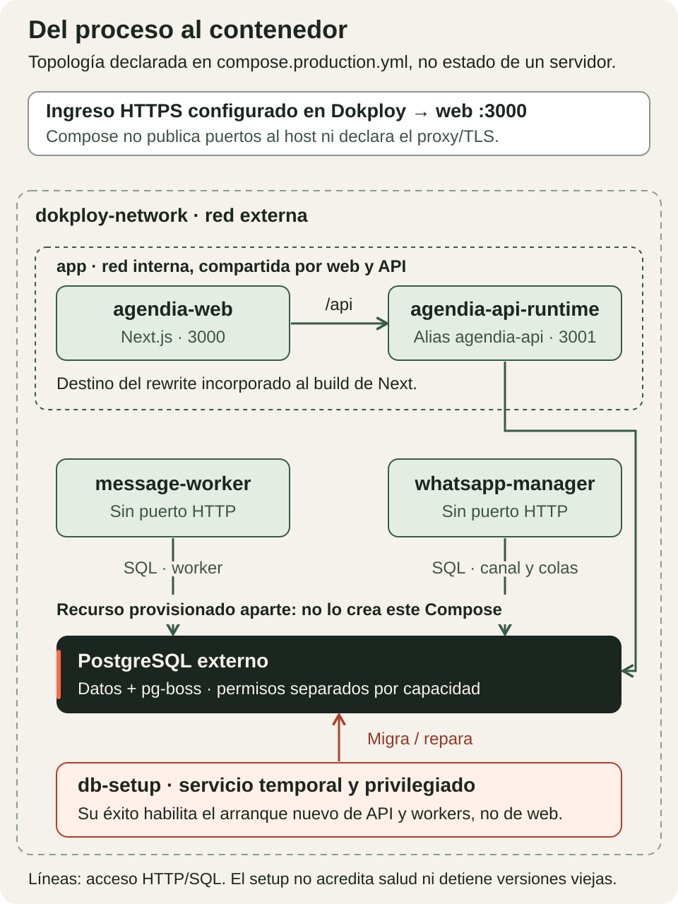

[Portada](../README.md) / [Índice de documentación](README.md) / Arquitectura

# Una agenda, dos formas de usarla

**El panel web y el agente de WhatsApp trabajan sobre una misma agenda en PostgreSQL.** La web permite administrarla; el agente la consulta y opera mientras conversa con el cliente. No hay dos calendarios que sincronizar ni una agenda guardada en la memoria del modelo.

Para hacerlo, agendIA separa cuatro procesos: **web, API, manager de WhatsApp y worker de mensajes**. PostgreSQL conserva los datos y el trabajo pendiente; WhatsApp y DeepSeek son servicios externos. Este mapa muestra responsabilidades, no una distribución obligatoria en máquinas distintas.

**Lectura rápida:** el mapa y los dos recorridos muestran cómo se conectan las piezas. Para entender sus garantías y límites, seguí con el agente, la concurrencia y los ciclos de vida.

- **Mapa:** [Vista general](#mapa-general) · [Procesos](#qué-hace-cada-proceso) · [Capas internas](#capas-internas-y-reglas-compartidas).
- **Recorridos:** [Panel y HTTP](#el-camino-del-panel) · [Mensaje de WhatsApp](#el-camino-de-un-mensaje) · [Interior del agente](#dentro-del-agente).
- **Fronteras:** [Concurrencia y reintentos](#concurrencia-e-idempotencia) · [Identidades y negocios](#identidades-y-ciclo-de-vida-del-negocio) · [Conexión de WhatsApp](#ciclo-de-vida-de-la-conexión-de-whatsapp).
- **Despliegue:** [Contenedores y redes](#del-mapa-lógico-al-despliegue) · [Decisiones y límites](#por-qué-esta-separación) · [Dónde seguir en el código](#dónde-seguir-en-el-código).

## Mapa general

Hay dos caminos hacia los mismos datos:

- **Desde el panel:** navegador → web → API → PostgreSQL. La API comprueba permisos y valida las operaciones del negocio.
- **Desde WhatsApp:** WhatsApp ↔ manager; PostgreSQL coordina el trabajo entre manager y worker. El worker consulta a DeepSeek, ejecuta herramientas y guarda el resultado; el manager entrega la respuesta.

Las flechas hacia la base representan lecturas y escrituras, no acceso irrestricto. Cada proceso tiene capacidades acotadas. **Ni la web ni DeepSeek escriben directamente en la agenda.**

## Qué hace cada proceso

### Web: la interfaz del negocio

El panel, construido con **Next.js**, presenta la agenda y permite gestionar servicios, recursos, horarios, clientes y configuración del agente. También ofrece las pantallas de acceso y administración de la plataforma.

La web solicita datos y operaciones a la API. No mantiene una copia independiente de la agenda ni decide permisos por mostrar u ocultar un botón: la autorización real ocurre en el backend.

### API: la entrada del panel al backend

La **API Fastify** recibe las solicitudes HTTP, comprueba la sesión y el rol, valida los datos y ejecuta las operaciones mediante los repositorios. Para las modificaciones del panel comprueba también el origen y la protección contra solicitudes falsificadas, conocida como CSRF.

La API no mantiene conexiones de WhatsApp ni ejecuta la conversación con el modelo. Su papel es atender al panel y aplicar sus controles de acceso; no es un paso obligatorio para todo lo que ocurre dentro del sistema.

### Manager de WhatsApp: la conexión y la entrega

El proceso **`whatsapp-manager`** mantiene las sesiones del canal mediante Baileys. Recibe mensajes, identifica a qué negocio pertenecen y registra las entradas aceptadas. También publica el trabajo de IA pendiente en la cola y toma las respuestas guardadas para enviarlas.

**Es el único de los cuatro procesos que envía mensajes por WhatsApp.** No genera la conversación con DeepSeek ni decide las reglas de disponibilidad: coordina el canal, la entrada y la salida.

### Worker de mensajes: el agente en ejecución

El proceso **`message-worker`** consume el trabajo de la cola y ejecuta la conversación. Prepara contexto, consulta a **DeepSeek** y atiende sus llamadas a herramientas: leer servicios, buscar disponibilidad u operar un turno, por ejemplo. También procesa resúmenes de conversaciones para acotar el contexto que usa el agente.

El modelo propone texto y acciones; **el código del backend valida y ejecuta las herramientas**. El worker accede a los repositorios directamente, sin hacer una petición HTTP a la API. Al terminar guarda los efectos y, si corresponde, una respuesta pendiente. No abre sockets de WhatsApp ni envía esa respuesta al cliente.

### PostgreSQL: datos y coordinación durable

PostgreSQL guarda la configuración, los clientes, los turnos y las conversaciones. También conserva qué se recibió, qué falta procesar y qué respuesta está pendiente de envío. Las colas de **pg-boss** viven en esa misma base: no representan un quinto proceso de agendIA ni requieren otro servidor de colas.

Las reglas no pertenecen solo a la API o al prompt. Se sostienen entre **políticas de dominio, validaciones y transacciones de los repositorios, y restricciones de la base**. Así, el panel y el agente operan sobre el mismo estado sin delegar en la IA la integridad de la agenda.

## Capas internas y reglas compartidas

La API y el worker tienen entradas diferentes, pero reutilizan las mismas piezas de negocio. Los paquetes compartidos son **código dentro de los procesos, no servicios adicionales**.

- **Entradas y contratos:** las rutas del panel y las herramientas del agente reciben pedidos, comprueban su forma y establecen quién puede actuar. Un dato bien formado todavía puede ser rechazado por las reglas de agenda.
- **Dominio:** expresa políticas como disponibilidad, anticipación y cambios permitidos, sin depender del canal o del modelo.
- **Repositorios y transacciones:** consultan el estado actual, aplican esas políticas y guardan una operación completa con su evidencia. PostgreSQL añade restricciones de integridad y aislamiento.
- **Adaptadores de proveedores:** traducen las llamadas a DeepSeek y los eventos de Baileys; no son dueños de las reglas del negocio.

Esta separación evita mantener una versión de la agenda para la web y otra para WhatsApp. También permite cambiar la interfaz o un proveedor sin trasladarle las decisiones de disponibilidad. **El worker reutiliza dominio y persistencia directamente: no pasa por la API.**

Para cambiar una regla, el punto de partida es el [dominio](../packages/domain/src) y su aplicación en los [repositorios](../packages/db/src/repositories). Para cambiar cómo se pide una operación, se revisa la entrada correspondiente. Un cambio de prompt puede orientar al agente, pero no reemplaza esas validaciones. Las garantías físicas y sus límites están en [Base de datos](database.md#garantías-al-guardar).

## El camino del panel

Cuando el negocio consulta o modifica su agenda, el navegador usa rutas relativas bajo `/api`. El [rewrite de Next.js](../apps/web/next.config.ts) las dirige a la API cuando está configurado su destino.

La API comprueba quién está actuando y sobre qué negocio puede operar. Después valida la solicitud y usa los repositorios para leer o guardar. En una modificación de agenda vuelve a comprobar el estado y la disponibilidad: una opción que se veía libre puede haber dejado de estarlo.

Las escrituras de negocio que pasan por la unidad de trabajo confirman juntas **la modificación, su auditoría y el evento pendiente asociado**. La API devuelve el resultado al panel; para este camino no necesita pasar por DeepSeek ni por WhatsApp.

## El camino de un mensaje

1. **Recibir.** El manager identifica el negocio, filtra la entrada y registra el texto aceptado con trabajo pendiente para el agente.
2. **Procesar.** El worker toma ese trabajo, prepara el contexto y conversa con DeepSeek. Las acciones pasan por herramientas que el backend valida y ejecuta.
3. **Guardar.** PostgreSQL confirma juntos los cambios de agenda que correspondan y la respuesta pendiente. El modelo no escribe directamente en la base.
4. **Enviar.** El manager toma la respuesta guardada e intenta entregarla por WhatsApp, registrando el resultado del canal.

El trabajo pendiente y la cola de pg-boss conectan recepción y procesamiento **sin una llamada HTTP directa entre manager y worker**. Si un mensaje nuevo vuelve obsoleto el trabajo anterior, no es obligatorio responder a ambos.

**Guardar no es entregar:** un turno permanece aunque falle el envío de su confirmación. La entrega puede quedar incierta, y los reintentos no garantizan «exactamente una vez»; para propuesta y aceptación, seguí el [recorrido de una reserva](booking-journey.md).

## Dentro del agente

El agente combina conversación y herramientas, pero su autoridad termina donde empiezan las reglas del backend. **DeepSeek propone texto y acciones; no recibe una conexión a la base.**

### Contexto y estado no son lo mismo

El contexto reúne perfil, estilo e indicaciones del negocio, mensajes recientes, un resumen de la conversación y la entrada actual del cliente. Se prepara de forma acotada para que el modelo tenga información útil sin recibir todo el historial. Las indicaciones del negocio entran como datos de atención, no como permisos para saltarse los controles del sistema.

El resumen ayuda a recordar qué se habló, pero no demuestra que exista un turno. Las propuestas y los datos pendientes de agenda se conservan por separado en el estado de conversación del backend; los turnos guardados viven en PostgreSQL. Esa separación permite retomar el diálogo sin tratar una frase del modelo como un hecho confirmado. **Recordar una propuesta no significa reservar capacidad.**

### Conversar, validar y terminar

El [runtime del agente](../apps/message-worker/src/agent/runtime.ts) consulta al modelo y atiende sus pedidos de herramientas. Los argumentos se validan y las operaciones comprueban permisos, titularidad y condiciones actuales. Cada resultado vuelve a la conversación como información, rechazo, aclaración o acción provisional; solo el guardado final confirma los cambios.

Una respuesta puede necesitar varias consultas antes de terminar. El backend limita ese trabajo y exige una salida válida; también permite finalizar sin responder, siempre que el silencio no oculte cambios de agenda. Si la sesión falla antes de confirmar, sus cambios de base se revierten. Cerrar o cancelar una sesión no vuelve reversibles las llamadas externas que ya ocurrieron ni detiene instantáneamente todo trabajo en curso.

Las referencias de la conversación ayudan a comprobar que una acción corresponde al mensaje, al remitente y a la propuesta vigentes. No certifican por sí solas el significado de un «sí»: **la interpretación del lenguaje sigue siendo un límite del modelo**. Las herramientas reducen su autoridad, pero no convierten la conversación en una garantía de consentimiento perfecto.

## Concurrencia e idempotencia

Dos clientes pueden pedir el mismo lugar y una operación puede repetirse por un problema de conexión. El sistema necesita coordinar ambos casos sin confundirlos.

**Para los trabajos simultáneos**, serializa la generación de respuestas de una misma conversación y protege también el calendario del negocio. Son alcances distintos: dos conversaciones diferentes pueden competir por el mismo recurso. Antes de guardar se vuelve a comprobar disponibilidad, y PostgreSQL impide superponer turnos confirmados de un recurso. Una opción que estaba libre puede terminar en un rechazo, no en una segunda reserva.

Esto tiene un costo: el agente mantiene la protección del calendario durante su conversación con el proveedor. Una respuesta lenta puede hacer esperar al panel u otras conversaciones del mismo negocio. Separar procesos no elimina esa espera ni hace que agregar workers multiplique automáticamente la capacidad.

**Para las repeticiones**, se reconocen eventos ya recibidos y se comprueba si un trabajo sigue vigente. En el panel, el protocolo de operaciones de turnos guarda un comprobante: repetir la misma operación con la misma clave devuelve su resultado en lugar de crear otro turno. Reutilizar esa clave para otra operación produce conflicto; no es una garantía universal para cualquier petición.

Si una sesión falla antes de confirmar, puede reintentarse dentro de los límites del procesamiento y con una nueva comprobación de vigencia. Si lo incierto es un envío externo, repetirlo a ciegas podría duplicar un mensaje que sí llegó. Cancelar la espera de una solicitud tampoco demuestra que el servidor no la haya completado: **cancelar una solicitud y cancelar un turno son acciones distintas**.

La [unidad de trabajo](../packages/db/src/unit-of-work.ts) reúne los cambios del panel y su comprobante. Para diagnosticar trabajo pendiente o entregas inciertas, el detalle está en [Diagnóstico](operations.md#diagnóstico), no en una promesa de reintentos ilimitados.

## Identidades y ciclo de vida del negocio

El aislamiento empieza por distinguir quién actúa:

- **Administración de plataforma:** aprueba solicitudes, cambia el estado de los negocios y realiza la baja. No pertenece a un negocio ni recibe acceso general a conversaciones o credenciales.
- **Usuario del negocio:** administra su panel y está ligado a ese negocio. El modelo actual admite una identidad de este tipo por negocio, no un equipo con permisos personalizados.
- **Remitente de WhatsApp:** no es una cuenta del panel. La evidencia del canal permite comprobar qué turnos propios puede operar; un teléfono escrito en el chat o un identificador no prueban titularidad.

La sesión web y la autorización de cada ruta delimitan el acceso. Las operaciones internas también llevan contexto de negocio; PostgreSQL complementa esos controles con permisos y políticas por fila. **El negocio es la frontera de datos, no la pantalla o el proceso que atendió el pedido.**

El registro público crea una solicitud pendiente, no acceso inmediato. Al aprobarla, administración habilita negocio e identidad; al rechazarla, no se crea ese acceso. Luego el negocio configura su atención, activa el agente y vincula WhatsApp: son pasos separados. Tener sesión en el panel no significa estar conectado al canal ni tener automatización habilitada.

**Suspender conserva los datos y permite volver.** Se desactiva el acceso del negocio, se revocan sus sesiones y se impide procesar nuevas operaciones elegibles. Reactivar no recupera las sesiones revocadas: hace falta ingresar de nuevo.

**Dar de baja es irreversible en el modelo actual.** Se purgan datos activos y sesiones, se conserva auditoría y queda una marca que impide reactivar el negocio y escribir después de la baja. Eso no borra copias anteriores, mensajes entregados o todo trabajo ya publicado. Ni suspender ni eliminar prueban el cierre instantáneo de conexiones o envíos que ya estaban en curso.

Los detalles de [aislamiento](database.md#aislamiento-y-roles), [datos sensibles](database.md#datos-sensibles) y [baja de negocios](operations.md#baja-de-negocios) tienen sus propias referencias. Los controles de acceso no equivalen a cifrado de todos los datos ni protegen frente a un administrador de base con privilegios totales.

## Ciclo de vida de la conexión de WhatsApp

El manager mantiene la conexión del negocio con WhatsApp. **El estado del canal es independiente del estado del negocio y de la activación del agente:** una conexión abierta no habilita por sí sola las respuestas automáticas.

La vinculación se solicita desde el panel con sesión autorizada y agente activo. El manager procesa ese pedido y publica un QR temporal y cifrado para el panel. **Tener un QR o ver «vinculando» no acredita una conexión abierta**: eso depende de la confirmación del canal.

Ante un corte temporal, el manager intenta reabrir las sesiones elegibles con las credenciales guardadas. Si WhatsApp cerró la sesión o las credenciales dejaron de ser utilizables, puede hacer falta una nueva vinculación. Reiniciar el proceso no resuelve cualquier problema de acceso.

Para evitar que dos managers operen la misma conexión como propietarios actuales, PostgreSQL coordina su control. El envío exige propiedad vigente, negocio activo y conexión disponible. Si otro manager retoma una conexión con un envío a medias, conserva la incertidumbre en vez de asumir que el mensaje no salió. Esto protege el registro del sistema, pero no deshace llamadas de red ni garantiza que un socket anterior haya desaparecido al instante.

El punto de entrada de ese ciclo es el [manager de conexiones](../apps/whatsapp-manager/src/connection.ts). El diagnóstico del canal está en [Operaciones](operations.md#diagnóstico).

## Del mapa lógico al despliegue

El [Compose de producción](../compose.production.yml) despliega los cuatro procesos como servicios persistentes. Agrega un **setup temporal de base** antes del arranque nuevo de API y workers. PostgreSQL se provisiona aparte; pg-boss sigue dentro de esa base, sin un contenedor adicional de colas.

Web y API se comunican por una red interna. El navegador usa `/api` en el dominio del panel y Next lo dirige a la API, sin exigir exposición pública directa de esta. El destino interno se incorpora al construir la web: cambiar solo el entorno de una imagen ya construida no reconstruye ese camino. El ingreso HTTPS se configura en Dokploy; Compose no crea PostgreSQL ni publica puertos al host.

El setup aplica y valida migraciones. Si detecta la pérdida de permisos característica de un restore nativo de Dokploy, repara esos permisos y cancela trabajo pendiente restaurado antes de habilitar nuevos consumidores. Es una preparación privilegiada y temporal, no un servicio de negocio; los runtimes usan conexiones de base con capacidades acotadas, no el acceso del migrador.

**Esta puerta ordena el arranque, no acredita salud.** La web no espera a la API ni al setup, por lo que verla arrancar no demuestra que todo funcione. El setup tampoco ejecuta el restore, detecta cualquier problema de base o detiene versiones antiguas que ya estén trabajando.

Los procesos pueden reiniciarse por separado, pero siguen compartiendo la misma base y las restricciones del canal y del proveedor. Esta topología no promete alta disponibilidad por sí sola. La configuración, comprobaciones y recuperación están en [Operaciones](operations.md) y su [procedimiento de restore](operations.md#restore-de-dokploy).

## Por qué esta separación

**Cada parte tiene un ritmo distinto:** HTTP, conexiones persistentes y conversación con IA. Separarlas mantiene la generación fuera de una solicitud del navegador y permite distinguir fallos de procesamiento y de entrega.

**El estado importante es durable:** agenda, diálogo y trabajo pendiente no dependen de memoria compartida. Esto permite reconocer resultados, retomar trabajo y descartar lo obsoleto sin inventar otra agenda.

**Las fronteras siguen teniendo costo:** la coordinación por negocio puede aumentar la espera, y los proveedores están fuera de las transacciones de la base. La arquitectura busca preservar coherencia, no prometer que toda operación externa sea instantánea, reversible o entregada una sola vez.

## Dónde seguir en el código

Los puntos de entrada siguen el mapa: [web](../apps/web), [API](../apps/api/src/app.ts), [manager](../apps/whatsapp-manager/src/index.ts) y [worker](../apps/message-worker/src/index.ts). Para seguir las garantías de almacenamiento, continuá con [Base de datos](database.md); para reproducir o desplegar el sistema, con [Desarrollo](development.md) y [Operaciones](operations.md).

---

[Volver al índice](README.md)
