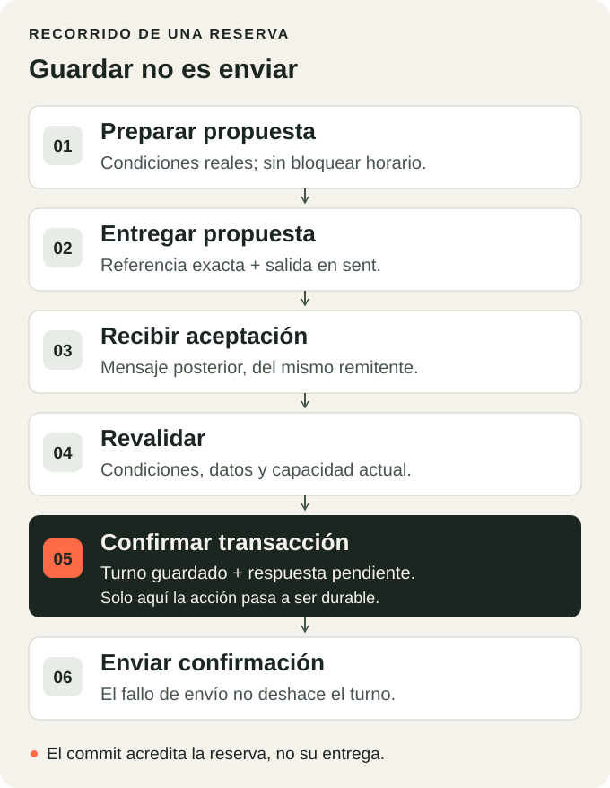

[agendIA](../README.md) / [Documentación](README.md) / Recorrido de una reserva

# De una propuesta a un turno guardado

**La reserva y su confirmación por WhatsApp son dos resultados distintos.** Primero se entrega una propuesta, el cliente la acepta y el backend vuelve a validarla. Después se guarda el turno junto con la respuesta pendiente; otro proceso intenta enviar esa respuesta.

Esta guía sigue una reserva nueva por el agente. Si necesitás el vocabulario, empezá por [Cómo funciona](overview.md); para ubicar procesos, seguí con [Arquitectura](architecture.md).

[Ejemplo](#01--elegir-una-opción) · [Entrega](#02--entregar-la-propuesta) · [Aceptación](#03--aceptar-lo-que-se-entregó) · [Guardado](#05--confirmar-la-transacción) · [Código y pruebas](#para-seguirlo-en-el-código)

## 01 · Elegir una opción

**Ejemplo ficticio, continuación del modelo del producto.** El negocio abre de 09:00 a 18:00; el recurso Alma atiende de 10:00 a 16:00, presta un servicio de 40 minutos y tiene ocupado de 11:00 a 11:40. Lucía Prado, remitente verificada de WhatsApp, pide un turno a las 12:00 para un día futuro. El servicio cuesta ARS 10.000 en este ejemplo.

El agente consulta catálogo, recursos y `availability`. Las 12:00 pueden servir si no hay cierres, el catálogo y la asociación están activos y falta al menos una hora para el inicio. La zona es `America/Argentina/Buenos_Aires`; los inicios siguen una grilla de 15 minutos, aunque el turno termine a las 12:40.

`prepare_booking` construye la propuesta con condiciones reales: servicio, recurso asignado, inicio, duración y precio. No inserta un turno ni bloquea ese horario. Si Lucía todavía no está registrada, también hacen falta su nombre y apellido; el teléfono viene del canal, no de un argumento inventado por el modelo.

**Hasta acá:** hay una opción o un borrador, no una reserva. La asignación de Alma tampoco significa que Lucía haya expresado una preferencia por ella.

## 02 · Entregar la propuesta

El modelo redacta, por ejemplo: «Servicio de 40 minutos con Alma a las 12:00, ARS 10.000. ¿Lo reservamos?». Es una ilustración, no una plantilla fija del sistema.

Para vincular esa respuesta con la propuesta, la salida final incluye su `presentedQuoteReference` vigente. El adaptador guarda el diálogo y una orden `outbound_commands` en estado `generated`; asocia el `outboundId` a la propuesta solo si se presentó esa referencia. El manager reclama la orden, llama al gateway y, si obtiene ACK, registra `sent`.

> **Entregada, en este protocolo, significa que esa orden exacta está en `sent`, para la misma conexión y remitente.** No es prueba de lectura humana. Texto generado sin referencia, otra respuesta del agente o una orden aún pendiente no acreditan la entrega de la propuesta.

## 03 · Aceptar lo que se entregó

Lucía responde en un mensaje posterior: «Dale, reservame ese». El modelo interpreta la aceptación y usa `confirm_quote_naturally` con el mensaje completo y las referencias que emitió el runtime para esa propuesta. También existe `confirm_quote` para la confirmación literal heredada; no es un segundo paso obligatorio después de la natural.

El backend verifica procedencia, remitente, propuesta y contexto de entrega. No admite confirmar una propuesta creada en el mismo mensaje ni reutilizar una referencia de otra selección o negocio.

- **Elegir las 12:00 no es aceptar** las condiciones que todavía no se entregaron.
- **Dar nombres no es aceptar.** Si ya hubo aceptación de la misma propuesta entregada, completar los nombres faltantes puede terminar la reserva sin pedir otra aceptación redundante.
- **Puede haber aceptación sin reserva:** `deferForBusinessRequirements` permite retenerla mientras faltan requisitos obligatorios del negocio; `finish_accepted_booking` continúa ese caso cuando corresponde.

**Límite semántico:** las referencias autentican evidencia y contexto; no prueban que el modelo entendió bien el consentimiento, la titularidad de un nombre o el cumplimiento de instrucciones. La IA puede interpretar mal un mensaje auténtico. La [definición de herramientas](../apps/message-worker/src/agent/tools.ts) explicita esa frontera.

## 04 · Revalidar antes de escribir

Entre la propuesta y la aceptación, otra persona pudo ocupar las 12:00 o el negocio pudo cambiar su configuración. El adaptador consulta disponibilidad otra vez y compara las condiciones con la propuesta aceptada. El repositorio vuelve a aplicar las reglas al crear el turno, bajo el lock de calendario del negocio.

| Si cambió… | Qué ocurre |
| --- | --- |
| La capacidad o el horario permitido | No se guarda esa reserva; se devuelve aclaración y, cuando hay, alternativas reales. |
| El precio u otras condiciones de la propuesta | Se prepara una propuesta actualizada: necesita nueva entrega y aceptación. |
| La titularidad de un turno a reprogramar | Se rechaza la operación; el ID por sí solo no autoriza. |
| Nada y están los datos requeridos | La herramienta puede devolver `staged_action`: la escritura todavía es provisional. |

PostgreSQL agrega una última barrera: la exclusión GiST impide superponer turnos `confirmed` del mismo recurso. No reemplaza las comprobaciones de catálogo, horarios ni consentimiento.

## 05 · Confirmar la transacción

La sesión del agente mantiene juntas las escrituras: cliente nuevo si corresponde, turno `confirmed` con origen `ai`, diálogo, comprobante de WhatsApp, auditoría, evento `appointment.changed` y respuesta `generated`. Si falla la persistencia o la salida final no es válida, la transacción se revierte; un `staged_action` visto durante la ejecución no acredita durabilidad.

Solo al retornar `committed` desde `withAgentSession` se confirma lo persistido. **Ese estado también existe para respuestas sin reserva:** para saber si hubo una acción hay que mirar `actions`, no solo `status`.

En el ejemplo exitoso, el turno conserva los nombres del servicio y recurso, ARS 10.000 y 40 minutos como condiciones acordadas. Los cambios posteriores de catálogo no reescriben esa copia. La respuesta «Quedó reservado» sigue siendo una orden pendiente de envío.

## 06 · Enviar la confirmación

El manager procesa esa orden por separado. El envío exitoso se registra como `sent`; un rechazo inequívoco, como `failed`; una excepción ambigua, como `delivery_unknown`.

**Si falla este envío, el turno ya guardado no se deshace.** Tampoco hay que reservar de nuevo para «reintentar la confirmación». `delivery_unknown` puede significar que el proveedor recibió el mensaje: no autoriza un reenvío ciego. Ver [Diagnóstico de envíos](operations.md#diagnóstico).

El contexto vigente importa: una entrada más nueva o una respuesta manual del negocio puede dejar obsoleta una respuesta generada antes de su reclamo. Los locks y comprobantes evitan efectos duplicados en los reintentos cubiertos, no prometen entrega externa exactamente una vez.

## Para seguirlo en el código

Leé en este orden; las pruebas son referencias de comportamiento, no una afirmación de que se ejecutaron al leer esta guía.

| Frontera | Implementación | Prueba que la explica |
| --- | --- | --- |
| Mensaje y remitente verificado | [Ingesta](../apps/whatsapp-manager/src/inbound.ts), [bindings](../packages/db/src/repositories/whatsapp-agenda.ts) | [Agenda por WhatsApp](../tests/integration/whatsapp-agenda.integration.test.ts) |
| Propuesta, entrega y aceptación posterior | [Adaptador de agenda](../apps/message-worker/src/agent/adapters/agenda.ts), [comprobación `sent`](../packages/db/src/repositories/whatsapp-agenda.ts#L55-L61) | [Propuesta sin entregar](../tests/integration/agent-tools.integration.test.ts#L938-L962), [aceptación antes de nombres](../tests/integration/agent-tools.integration.test.ts#L1662-L1688) |
| Revalidación y condiciones | [Repositorio de turnos](../packages/db/src/repositories/appointments.ts) | [Cambio de precio](../tests/integration/agent-tools.integration.test.ts#L978-L1004), [pérdida de capacidad](../tests/integration/agent-tools.integration.test.ts#L1024-L1036) |
| Efecto provisional frente a commit | [Sesión y resultado](../apps/message-worker/src/agent/tools.ts), [guardado atómico](../apps/message-worker/src/agent/adapters/agenda.ts#L410-L456) | [Rollback y reintento único](../tests/integration/agent-tools.integration.test.ts#L1037-L1061) |
| Reserva frente a entrega externa | [Dispatcher de salida](../apps/whatsapp-manager/src/outbound.ts), [cierre de envío](../packages/db/src/repositories/messaging.ts#L236-L284) | [Entrega conservadora](../tests/unit/outbound-delivery.unit.test.ts) |

**No todo pasa por esta secuencia.** El panel crea turnos manuales con [rutas HTTP propias](../apps/api/src/routes/appointments.ts) y revalidación de condiciones. Cancelación, notas y preferencia tienen reglas distintas; no agregues propuestas ni confirmaciones redundantes a esas acciones.

---

**Continuá → [Arquitectura](architecture.md)** para ubicar las responsabilidades, o [Base de datos](database.md) para entender qué conserva cada paso. [Volver al mapa](README.md).
