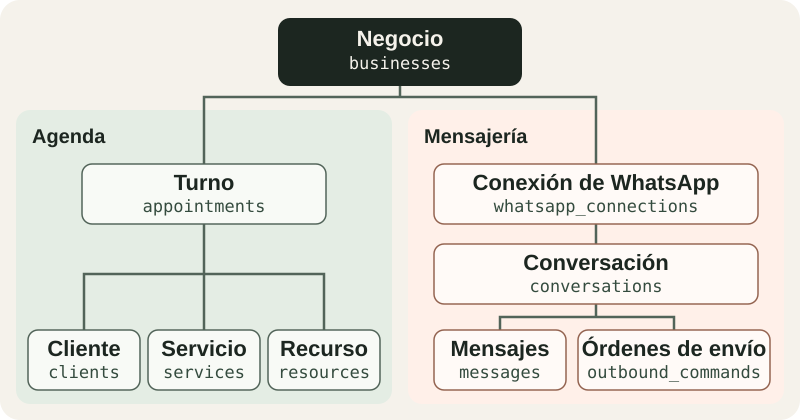

[Portada](../README.md) / [Índice de documentación](README.md) / Base de datos

# Base de datos

**El panel y el agente de WhatsApp usan la misma agenda en PostgreSQL.** Cada negocio tiene su propio catálogo, clientes y turnos. La base guarda por separado lo que se habló, el turno que se reservó y el estado del mensaje que avisa al cliente.

[Mapa](#mapa-del-modelo) · [Negocios y acceso](#negocios-y-acceso) · [Agenda](#agenda-y-reservas) · [WhatsApp](#conversaciones-y-envíos) · [Aislamiento y roles](#aislamiento-y-roles)

## Mapa del modelo

Las líneas muestran referencias entre las tablas principales, no pasos de una reserva. El turno no depende de que exista una conversación: también se puede cargar desde el panel.

### Relaciones y excepciones

**Integridad física frente a relación lógica:** las FK de agenda y mensajería usan normalmente `(business_id, id)` para impedir referencias a entidades de otro negocio. No todas siguen ese patrón: `outbound_commands.source_message_id` es una referencia lógica con índice único, no una FK; `appointment_operation_receipts.actor_id` referencia globalmente a `auth_identities`; `audit_events.business_id` puede ser NULL para la plataforma. No deduzcas una garantía SQL solo por el nombre de una columna.

## Negocios y acceso

`businesses` identifica al negocio. `business_id` indica a quién pertenecen sus datos. En la agenda, las referencias incluyen ese identificador: aunque exista el ID de un recurso de otro negocio, la base no deja asignarlo a este turno.

La cuenta del panel (`auth_identities`) y sus sesiones web son distintas de la ficha del cliente (`clients`). Un cliente no necesita una cuenta para reservar por WhatsApp. El panel usa la sesión para autorizar la operación; en PostgreSQL, los permisos por rol y las políticas de acceso por fila (RLS) acotan qué datos puede leer o escribir cada proceso.

## Agenda y reservas

Un **servicio** define lo que ofrecés, cuánto dura y cuánto cuesta. Un **recurso** es quien o lo que puede atender, como una profesional o un puesto de trabajo. `resource_services` registra qué servicios puede prestar cada recurso. Para calcular disponibilidad, el sistema cruza esa asignación con los horarios del negocio y del recurso, los cierres excepcionales y los turnos confirmados.

El **turno** (`appointments`) une un cliente, un servicio y el recurso asignado para un intervalo. También guarda una copia de los nombres del servicio y del recurso, el precio y la duración acordados. Si cambiás el precio en el catálogo, no se reescribe el de los turnos ya guardados. Los listados y detalles del turno muestran el `name` y el `phone` actuales del cliente. El registro admite búsquedas por nombre completo o teléfono y ordena por nombre sin distinguir mayúsculas.

### Garantías al guardar

Una propuesta por WhatsApp no bloquea el horario. Al guardar, el [repositorio](../packages/db/src/repositories/appointments.ts#L146-L180) toma un bloqueo de calendario por negocio y vuelve a comprobar las reglas de agenda y la ocupación. Como última barrera, la [restricción de exclusión de PostgreSQL](../packages/db/migrations/0000_base.sql#L398-L402) rechaza dos turnos `confirmed` que se pisan para el mismo recurso del mismo negocio. Esa restricción no comprueba horarios de apertura ni cierres.

> **Ejemplo:** si Alma ya tiene un turno confirmado de 10:00 a 10:30, no se le puede guardar otro de 10:15 a 10:45, aunque uno venga del panel y el otro de WhatsApp. A las 10:30 puede empezar otro: el intervalo incluye el inicio, pero no el final. Otro recurso habilitado puede atender a las 10:15 si está libre y cumple las demás reglas de agenda.

La [unidad de trabajo del panel](../packages/db/src/unit-of-work.ts) guarda juntas mutación, auditoría y trabajo pendiente. En las operaciones de turnos cubiertas por el protocolo de reintento, el comprobante guarda la clave por negocio y actor, una huella de la solicitud y el resultado. No cubre cualquier petición ni demuestra que el proveedor externo haya recibido una respuesta. La migración de nombre unifica también el cliente en los comprobantes históricos, sin cambiar sus huellas. Un alta anterior con nombre dividido se puede recuperar consultando su comprobante; reintentar con el formato de nombre único y la misma clave da conflicto, sin repetir efectos.

## Conversaciones y envíos

- **Conversación:** `conversations` agrupa el intercambio de WhatsApp y `messages` guarda el historial. Una propuesta pendiente guarda contexto para seguir hablando, no ocupa un lugar en la agenda.
- **Turno:** `appointments` registra la reserva. Una consulta de precios puede tener conversación y respuesta sin generar ningún turno.
- **Orden de envío:** `outbound_commands` guarda qué respuesta hay que mandar y cómo terminó el intento. `sent` significa que el canal confirmó el envío, no que el cliente lo leyó. Si falla el aviso de confirmación, **el turno que ya se guardó sigue reservado**.

## Aislamiento y roles

**RLS, permisos y autorización se complementan.** Las tablas de negocio usan `ENABLE` y `FORCE ROW LEVEL SECURITY`; `service_categories` se suma en 0006. Las globales —negocios, identidades, sesiones, controles y admisión de login/registro— dependen de ACL, funciones y verificaciones explícitas, no de una política tenant uniforme.

| Rol de capacidad | Uso principal |
| --- | --- |
| `agendia_runtime` | Operaciones del panel del negocio. |
| `agendia_admin_runtime` | Administración de plataforma, con accesos acotados. |
| `agendia_whatsapp_runtime` | Conexiones, credenciales, ingesta y entrega de WhatsApp. |
| `agendia_worker_runtime` | Contexto, herramientas de agenda, generación y resúmenes. |

Son roles `NOLOGIN` y `NOBYPASSRLS`, no usuarios finales. Los logins de conexión se [provisionan por capacidad](../scripts/db/provision-production-db.ts); el manager tiene también membresía de worker para su uso de colas. [`RolePool.run`](../packages/db/src/runtime-pools.ts) activa el rol y publica contexto transaccional local (`app.tenant_id`, actor y request).

Funciones de capacidad como `route_whatsapp_session` y `claim_owned_outbound` usan `SECURITY DEFINER` para enrutar sesiones o reclamar trabajo; su ejecución se revoca de `PUBLIC`. Administración puede leer datos no sensibles de solicitudes pendientes, pero no su hash de contraseña. Hay un solo `business_user` por negocio mediante índice parcial; la unicidad del administrador la controla el bootstrap, no la tabla.

RLS no es cifrado ni protege frente a superusuarios. Para comprobar el aislamiento al desarrollar, consultá [las pruebas RLS](../tests/integration/tenant-rls.integration.test.ts) y [las de esquema y permisos](../tests/integration/database-schema.integration.test.ts).

## Datos sensibles

| Dato | Tratamiento real |
| --- | --- |
| Contraseña | Hash Argon2id en `password_phc`; no es cifrado reversible. |
| Sesión y CSRF | Hash SHA-256 almacenado; no el token original de sesión. |
| Credenciales de WhatsApp | [AES-256-GCM](../packages/whatsapp-baileys/src/auth-store.ts), con clave de datos envuelta por clave de cifrado. |
| Código de vinculación | Cifrado, temporal; se elimina al consumirlo o limpiarlo, reemplazarlo o borrar su conexión. |
| Mensajes y resúmenes | Texto/JSON legible en la base; sin cifrado de aplicación. |
| Auditoría y diagnóstico | Pueden contener datos personales; el nombre `safe_details` no aplica un filtro automático. |

No copies textos reales, tokens, códigos ni credenciales a ejemplos, logs o capturas. Cifrado de disco, copias y retención son decisiones de despliegue, no garantías de este esquema.

---

[Volver al índice](README.md) · [Diccionario de tablas](database/tables.md)
