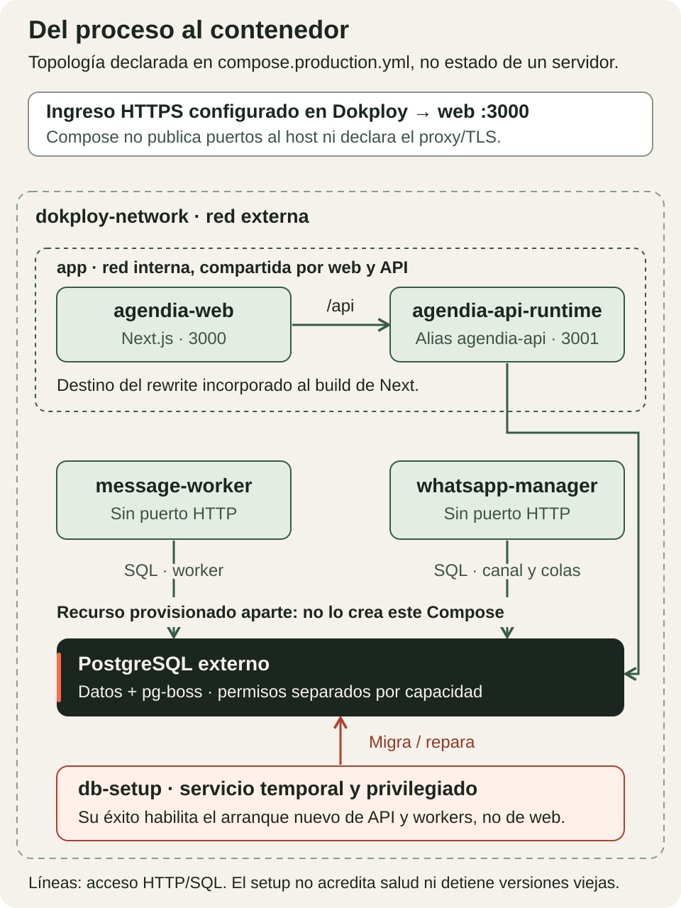

[agendIA](../README.md) / Operaciones

# Desplegar y operar agendIA en Dokploy

**No des por bueno el despliegue hasta entrar al panel y recibir una respuesta automática en un chat de prueba.** Si una de esas comprobaciones falla, ubicá dónde se cortó el recorrido antes de reiniciar procesos o tocar la base. Para ensayar fuera de producción, usá [Desarrollo local](development.md).

[Despliegue](#despliegue) · [Comprobaciones](#comprobaciones) · [Diagnóstico](#diagnóstico) · [Recuperación de PostgreSQL](#recuperación-de-postgresql)

## Despliegue



### Antes de desplegar

- Elegí una revisión del repositorio y configurá Dokploy para construirla con [`compose.production.yml`](../compose.production.yml). Provisioná PostgreSQL aparte: su host privado tiene que resolver y ser alcanzable desde `dokploy-network`, la red externa que espera Compose.
- Configurá el dominio HTTPS hacia `agendia-web:3000` y poné ese origen público exacto, sin barra final, en `APP_ORIGIN`. No expongas la API directamente: el `/api` público pasa por el proxy de Next hacia `http://agendia-api:3001`, destino fijado al construir la web.
- Cargá por un canal privado todas las variables obligatorias de Compose, incluso si solo vas a arrancar el setup. Usá las URLs de cada login con permisos acotados para los runtimes; `MIGRATOR_DATABASE_URL` es para el setup, no para la aplicación. El worker necesita `DEEPSEEK_API_KEY`; la API y el manager comparten `WHATSAPP_LINK_CODE_KEY`. La clave de vinculación y `BAILEYS_KMS_KEY` son claves distintas de 32 bytes codificadas en base64. Conservá las claves y la versión del KMS separadas del backup.

### Primera instalación: preparar una base vacía

1. **Migrá antes de arrancar los runtimes.** Confirmá el destino vacío y que el migrador pueda crear roles y objetos, instalar `btree_gist` y otorgarse la membresía privada que requiere la [migración 0007](../packages/db/migrations/0007_private_business_purge.sql). Desde la raíz de la revisión elegida, en el contexto de Compose del destino y con la configuración ya inyectada, ejecutá:

   ```bash
   docker compose -f compose.production.yml run --build --rm agendia-db-migrate
   ```

   Esperá código **0** y `Database migrations applied; no restore repair needed.`. Esto crea el esquema y los roles de capacidad, no los logins. Si falla, frená: no arranques la aplicación ni saltees el historial de migraciones.
2. **Provisioná los logins.** En un entorno de administración con Bun 1.4.0, dependencias instaladas y acceso a la misma base, inyectá `DATABASE_URL` del migrador y las cuatro variables `*_DB_PASSWORD` del [script de provisión](../scripts/db/provision-production-db.ts). Ejecutá `bun --no-env-file scripts/db/provision-production-db.ts` y esperá `Production database setup completed`. Las URLs runtime de Dokploy tienen que corresponder a esos logins. No repitas la provisión en cada deploy: puede cambiar contraseñas y membresías existentes.
3. **Creá el primer administrador.** En ese entorno ejecutá `bun --no-env-file scripts/db/bootstrap-admin.ts` con `AGENDIA_ADMIN_EMAIL`, `AGENDIA_ADMIN_PASSWORD` y una `DATABASE_URL` autorizada para leer e insertar en `auth_identities`, no la del login API. El [bootstrap](../scripts/db/bootstrap-admin.ts) exige una contraseña de al menos 16 caracteres que no empiece por `password`, `contraseña` ni `123456` (sin distinguir mayúsculas). Esperá `admin.bootstrap` con `created` o `existing`; repetir el mismo correo no cambia la contraseña. Ahora desplegá en Dokploy y hacé las [comprobaciones](#comprobaciones).

### Actualización: usar la base existente

1. Revisá migraciones y compatibilidad con la revisión en uso. Antes de migrar, tené una copia cuya restauración hayas comprobado y conservá la revisión anterior. Si el esquema no es compatible, bloqueá el tráfico y detené todos los escritores afectados, incluidos los workers y managers de revisiones viejas.
2. Desplegá la revisión elegida sin repetir la provisión ni el alta del administrador. Confirmá en Dokploy que `agendia-db-migrate` **de esa revisión** terminó con código 0: la API, el worker y el manager esperan su éxito en un arranque nuevo; la web no. Esa dependencia no detiene procesos viejos que ya están corriendo.
3. Repetí las comprobaciones antes de dar por cerrado el cambio. Si falla la migración, revisá sus logs y el historial sin editar el registro ni repetir SQL a mano. Volver a la versión anterior de la aplicación no revierte el esquema.

## Comprobaciones

1. **Arranque y proxy.** Revisá en Dokploy el estado y los logs del setup y de los cuatro procesos. Sin sesión, un `GET /api/me/business-profile` por el dominio público debe devolver **401 / `UNAUTHENTICATED`**. Si falla, comparalo con `GET http://agendia-api:3001/me/business-profile` desde un cliente en la red `app`. El 401 esperado prueba llegada a la API, no acceso a la base. Compose no declara un healthcheck de aplicación.
2. **Panel.** Ingresá por `/admin/login` y comprobá la lista de negocios. Si todavía no tenés un negocio de prueba autorizado, solicitá el alta por `/register` y aprobala en administración. Entrá con su cuenta por `/login` y comprobá que cargue su agenda o catálogo. Ver solo la pantalla de inicio no prueba este recorrido.
3. **WhatsApp real.** En el negocio de prueba, cargá un servicio ficticio y activá las respuestas automáticas en **Agente**. En **WhatsApp**, vinculá con el QR si hace falta y esperá **Conectado**. Desde otro número de prueba, en un chat individual, mandá «¿Qué servicios ofrecen?» y comprobá que la respuesta automática llegue a ese mismo chat. No confundas la espera configurada con un fallo: por defecto son 10 minutos para una conversación nueva y 90 segundos en una activa, más el tiempo de procesamiento y envío. Si probás una reserva, configurá también un recurso y sus horarios, y verificá el turno en el panel por separado.

## Diagnóstico

Anotá revisión, hora y negocio afectado. Seguí el mismo mensaje de prueba en orden; si necesitás mirar PostgreSQL, usá acceso autorizado de solo lectura y acotá la consulta al caso. No copies texto de chats, QR ni claves a los reportes.

| Dónde se corta | Qué mirar antes de tocar nada |
| --- | --- |
| **Recepción: no aparece la entrada** | Revisá el estado de WhatsApp en el panel y los logs del `agendia-whatsapp-manager`. Confirmá negocio y agente activos, un texto individual y un remitente distinto del número vinculado. Buscá la entrada en `messages` y el motivo del descarte en `technical_events` si quedó registrado. |
| **Worker: la entrada está, pero no hay respuesta generada** | Mirá `messages.processing_state` y `next_attempt_at` del evento `ai.generate` en `outbox_events`. Si ya venció la espera y sigue sin publicarse, revisá el manager: es quien encola en pg-boss. Si el job está en `ai-generate`, revisá el `agendia-message-worker`, el acceso a DeepSeek y si la automatización está deshabilitada o el mensaje quedó reemplazado por otro más reciente. No fuerces estados ni borres jobs. |
| **Salida: se generó, pero no llegó** | Revisá `outbound_commands.state` y la conexión del manager. `sent` registra la confirmación del canal, no la lectura por el cliente. `delivery_unknown` significa que pudo haber salido: contrastá con el chat antes de decidir qué hacer, no reenvíes a ciegas. Un fallo del aviso no deshace un turno guardado. |

Para ubicar responsabilidades, mirá [el camino de un mensaje](architecture.md#el-camino-de-un-mensaje) y [cómo se guardan conversación, turno y envío](database.md#conversaciones-y-envíos).

## Recuperación de PostgreSQL

**No restaures encima de producción como primer intento.** El [procedimiento de Restore de Dokploy](#restore-de-dokploy) está más abajo, incluido el preflight destructivo de `pgboss`; no lo uses como arreglo de una cola trabada.

1. **Antes del restore:** confirmá origen, fecha y alcance de una copia validada que incluya `pgboss`; acordá cuántos datos se pueden perder. Conservá la base original sin sobrescribir y elegí un destino aislado. Verificá la revisión y el historial compatibles, los roles y logins del cluster, y las claves y versiones necesarias para leer las credenciales cifradas. El migrador de la reparación tiene que ser superusuario y poder crear una base temporal de referencia en el mismo cluster.
2. **Antes del preflight y hasta validar:** confirmá que el destino autorizado coincida con `MIGRATOR_DATABASE_URL`, detené los runtimes de **todas** las revisiones que puedan operar ahí y evitá redeploys. Bloqueá tráfico y acceso a WhatsApp y DeepSeek. Restore no detiene consumidores ni ejecuta el setup; las credenciales y jobs restaurados podrían reactivar trabajo viejo. Si no podés asegurar el aislamiento, el destino o el alcance del preflight, frená.
3. **Después del Restore:** exigí salida 0 y revisá el diagnóstico. Ejecutá solo `agendia-db-migrate` de la revisión elegida, todavía sin consumidores. El [setup](../scripts/db/restore-aware-setup.ts) migra y comprueba dos permisos; no detecta cualquier restore. Si esperabas reparación, buscá salida 0 y `Restore detected. Repaired …` con los conteos. Si el restore o el setup falla, puede haber cambios parciales: dejá todo detenido. Hacé lo mismo si esperabas reparación y el setup informa `no restore repair needed`.
4. **Antes del corte:** verificá historial, permisos y aislamiento por fila, acceso al panel, agenda y trabajo pendiente con datos controlados y sin proveedores reales. La [reparación](../scripts/db/repair-restored-db.ts) reconstruye propietarios y permisos a partir de las migraciones actuales; no valida todos los datos ni las políticas por fila. Marca el outbox pendiente como publicado **sin publicarlo**, vacía `pgboss.job`, marca como fallidos los comandos `pending`, `processing` y `generated`, y deja los que estaban `sending` en `delivery_unknown`. Sin reparación, el setup no cancela ese trabajo.
5. **Recién después, reabrí.** Reconciliá turnos posteriores a la copia, datos borrados que pudieron reaparecer y mensajes ya enviados. No reproduzcas trabajo cancelado ni reenvíes respuestas inciertas sin verificar: restaurar PostgreSQL no deshace mensajes que ya llegaron. Con el corte aprobado, habilitá consumidores y proveedores de forma controlada y repetí las [comprobaciones](#comprobaciones) antes de liberar el tráfico general.

### Backups

**Capturar una copia no es restaurarla ni repararla.** La captura y la retención de backups dependen del proveedor de PostgreSQL, Dokploy o la infraestructura operada; no hay automatización de captura en este árbol. Sí hay [reparación posterior al Restore nativo de Dokploy](#restore-de-dokploy): el setup reconstruye propietarios/permisos y cancela trabajo restaurado cuando detecta la pérdida de permisos característica de ese restore.

Antes de una migración incompatible, baja o cualquier operación irreversible, exigí:

1. **Copia identificada y restauración comprobada**, con punto de recuperación, alcance y pérdida de datos aceptable explícitos. Que un dump exista o termine sin error no basta.
2. **Destino nuevo y aislado**, sin tráfico ni procesos que puedan contactar WhatsApp/DeepSeek. Restaurar credenciales y jobs puede reactivar conexiones o trabajo antiguo si arrancás un manager/worker.
3. **Configuración recuperable:** versión de aplicación e historial de migraciones correspondientes, roles/logins y permisos requeridos, claves de cifrado/versiones y tratamiento del estado de colas. Un dump de datos no sustituye esa configuración.
4. **Validación antes del cambio:** integridad, aislamiento RLS, autenticación, agenda y estado pendiente, sin proveedores reales. Validá primero el historial restaurado; aplicá pendientes solo con compatibilidad revisada. No migres por reflejo una copia que necesitás para volver atrás.

No restaures sobre producción como primer intento. Mantené la instancia original sin sobrescribir, detené escritores durante el corte acordado y habilitá tráfico solo tras validar la candidata. Reconciliá lo ocurrido después de la copia: una restauración puede perder turnos recientes o reintroducir datos eliminados y no deshace mensajes enviados fuera del sistema.

Borrar volúmenes, purgar colas o reemplazar una base son acciones destructivas, no pasos de diagnóstico. Requieren autorización, aislamiento y copia validada; el único borrado descrito abajo es el preflight acotado de recuperación, nunca un arreglo genérico.

### Restore de Dokploy

**Solo con autorización para reemplazar la base seleccionada y perder su trabajo efímero.** Ensayá primero en un destino aislado con las salvaguardas anteriores. El botón Restore no detiene consumidores ni ejecuta el setup de la aplicación; el arranque nuevo sí lo ejecuta antes de API y workers. No protege frente a procesos viejos todavía activos.

Antes de empezar, confirmá que `MIGRATOR_DATABASE_URL` apunte exactamente al cluster/base elegidos en Restore, con un migrador **superusuario**, espacio y permiso para crear una base de referencia temporal. Deben existir los roles de capacidad y los logins con sus membresías y atributos seguros; para un cluster nuevo, preparalos según [Puesta en marcha](#primera-instalación-preparar-una-base-vacía) en una base vacía antes de restaurar. El backup de una base no incluye los roles del cluster ni las claves de entorno.

1. **Detené y aislá todo.** Detené API, web, worker y manager de todas las revisiones y evitá redeploys hasta terminar. Bloqueá tráfico y contacto con WhatsApp/DeepSeek también durante la validación posterior: restaurar credenciales puede reconectar sesiones.
2. **Preflight de pg-boss, solo en el destino autorizado.** Con copia validada que incluya el esquema `pgboss`, confirmá identidad de la base, revisá dependencias y aceptá la pérdida de sus colas actuales. `CASCADE` puede eliminar objetos dependientes fuera del esquema; si hay dependencias ajenas, detené el procedimiento. Solo con ese alcance comprobado, descartá el esquema antes del Restore:

   ```bash
   psql "$MIGRATOR_DATABASE_URL" -c 'DROP SCHEMA IF EXISTS pgboss CASCADE;'
   ```

   Con tablas particionadas presentes, `pg_restore --clean` puede fallar al borrar constraints heredadas (`job_common_pkey`, `queue_stats_*_pkey`). Este preflight evita ese conflicto; **no garantiza el éxito del resto del restore**. El archivo debe recrear esquema, tablas y jobs; luego el setup cancela los jobs restaurados.
3. **Restaurá el archivo validado.** En Dokploy, **Backups → Restore Backup**, elegí el archivo y la base confirmados. El flujo nativo usa `pg_restore -O --clean --if-exists`; reconstruye objetos sin los propietarios originales y, con el backup nativo sin ACL, pierde permisos de capacidad. Exigí código **0** y revisá el diagnóstico completo. Ante cualquier fallo, mantené todo detenido: no supongas que recuperar algunas filas equivale a éxito ni arranques workers para recrear lo que falta.
4. **Ejecutá el setup sin abrir tráfico ni proveedores.** En el contexto de Compose autorizado, usá el mismo servicio de [inicialización](#primera-instalación-preparar-una-base-vacía). Aplica migraciones pendientes y luego sondea dos permisos: `SELECT` de `agendia_runtime` en `businesses` y `UPDATE (published_at)` de `agendia_worker_runtime` en `outbox_events`. Si falta alguno, repara y cancela trabajo. No es un detector universal de restores ni de corrupción; no revoques permisos para forzarlo.
5. **Verificá antes de habilitar consumidores.** El setup debe terminar con código **0**. Una reparación imprime `Restore detected. Repaired …`, con cantidades de propietarios, permisos y trabajo cancelado. Con los dos permisos presentes imprime `Database migrations applied; no restore repair needed.` y no cancela trabajo. Si esperabas reparación y no ocurre, no habilites consumidores sin investigar. Validá historial, permisos, RLS y el estado de trabajo antes del arranque; después repetí [las comprobaciones de acceso y agenda](#comprobaciones) con datos controlados y proveedores todavía bloqueados.
6. **Reconciliá y recién después reabrí.** Revisá turnos posteriores a la copia, datos eliminados que pudieron reaparecer y envíos ya efectuados. Habilitá consumidores, proveedores y tráfico solo según el corte aprobado, sin reenvíos automáticos del trabajo cancelado o incierto.

La [reparación](../scripts/db/repair-restored-db.ts) usa las migraciones desplegadas como política actual, no los permisos históricos del archivo. Compara el inventario de objetos con una base de referencia, repara propietarios/ACL y asigna objetos de `pgboss` a `agendia_worker`; **no valida toda la estructura, las políticas RLS ni los datos**. Intenta eliminar solo la referencia creada por esa ejecución; si no puede, emite una advertencia con su nombre.

| Trabajo restaurado | Efecto de la reparación |
| --- | --- |
| Outbox sin publicar | Marca `published_at` y libera el reclamo **sin publicarlo**. |
| Comandos `pending`, `processing`, `generated` | Pasan a `failed`, con `failure_code = restore_cancelled`; libera su propiedad/reclamo. |
| Comandos `sending` | Pasan a `delivery_unknown`, también con `restore_cancelled`; libera su propiedad/reclamo. |
| Otros comandos | Conservan su estado. |
| Jobs de `pgboss.job` | Vacía todas sus filas, incluidas sus particiones; no borra el esquema. |

**Si falla el restore o el setup, dejá la aplicación detenida.** Puede haber cambios parciales; ni el restore ni toda la reparación son una única transacción. Después del preflight puede faltar `pgboss`: crear solo el esquema o arrancar un worker no repone sus permisos ni valida la recuperación. Diagnosticá y reintentá el procedimiento validado antes de habilitar consumidores. En un reinicio normal con permisos sanos se preserva el trabajo pendiente; una reparación no revierte mensajes ya entregados ni garantiza entrega exactamente una vez.

## Baja de negocios

**Suspender permite volver; eliminar no.** El camino implementado es el panel de administración y su [ruta protegida](../apps/api/src/routes/administration.ts), no invocar funciones SQL privadas.

| Acción | Efecto y límite |
| --- | --- |
| Suspender / reactivar | Cambia `businesses.status`; la suspensión impide sesión operativa y ruteo del agente, pero conserva datos. No garantiza drenar envíos ya iniciados. |
| Eliminar | Con sesión administrativa vigente, origen y CSRF, `DELETE /admin/businesses/:id` ejecuta la baja transaccional: purga datos activos y sesiones, libera el correo y conserva auditoría e identidad del negocio con `deleted_at` irreversible. Desaparece de la lista administrativa; no hay deshacer. |

Antes de confirmar **Eliminar**, verificá identidad y alcance del negocio, autorización y [copia con recuperación validada](#backups). Aislá el tráfico y detené workers/managers de **todas** las versiones que puedan operar ese negocio; conservá solo el acceso administrativo controlado necesario para la baja. La copia no es un botón de recuperación selectiva: restaurarla requiere un plan aislado y respetar las obligaciones de retención/borrado.

[La migración 0007](../packages/db/migrations/0007_private_business_purge.sql) instala barreras contra escrituras posteriores, pero no elimina jobs ya publicados en `pgboss`, copias previas ni mensajes entregados. Una identidad referenciada por otro negocio puede quedar anonimizada e inactiva. No se garantiza el cierre/drenaje de sockets antiguos ni que toda llamada al proveedor haya comenzado antes de la baja: [la frontera asíncrona está explicada en Arquitectura](architecture.md#identidades-y-ciclo-de-vida-del-negocio).

No otorgues el rol privado `agendia_business_purge` a logins runtime, no invoques `purge_business_data_private` manualmente ni intentes quitar la marca de baja.

## Release

[`.github/workflows/publish.yml`](../.github/workflows/publish.yml) se activa al publicar un tag `v*`, exige que su versión coincida con [`package.json`](../package.json) y crea un GitHub Release con notas generadas. **No corre las suites, no publica imágenes y no despliega.** La [CI de PR a `main`](development.md#ci) es independiente; el operador debe comprobar sus resultados para la revisión elegida.
