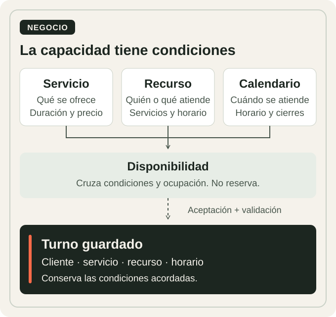

[agendIA](../README.md) / [Documentación](README.md) / Modelo del producto

# Qué agenda agendIA

**agendIA conecta una conversación de WhatsApp con la agenda real de un negocio.** El negocio define su oferta y su capacidad de atención; el agente ayuda al cliente a elegir; el backend valida y guarda lo acordado.

No es solo un chatbot con un calendario al lado. Una respuesta del modelo no demuestra que haya un turno: la reserva existe cuando la operación se confirma en la base de datos.

[Conceptos](#las-piezas-del-producto) · [Disponibilidad](#abierto-no-significa-disponible) · [Turnos](#qué-significa-un-turno-guardado) · [Agente](#el-agente-conversa-el-backend-valida) · [Código](#del-concepto-al-código)

## Quién hace qué

**El negocio** usa el panel con el rol `business_user`. Configura perfil, servicios, recursos, horario y cierres; mantiene clientes y turnos; define instrucciones del agente y vincula su WhatsApp.

**El cliente** es quien escribe por WhatsApp y para quien se registra el turno. No es un usuario del panel: su identidad de remitente se obtiene del canal, no de un teléfono que el modelo haya leído en el chat. Si reserva para otra persona, el cliente sigue siendo quien escribe; los detalles pertinentes pueden quedar en las notas del turno.

**Administración de la plataforma** usa `platform_admin`, separado del negocio. Decide solicitudes de acceso, suspende o reactiva negocios y gestiona su baja. No es otro recurso al que se le puedan asignar turnos.

> **Acceso al producto:** el registro genera una solicitud pendiente; aprobarla crea el negocio y su identidad de acceso. No hay verificación de correo. La baja administrativa sí existe: elimina datos activos y conserva auditoría e identidad de negocio como marca de baja. No equivale a borrar todo rastro histórico ni las copias anteriores. Ver [los límites de la baja](ARCHITECTURE.md#baja-de-negocios).

## Las piezas del producto

### Negocio · el límite de los datos

Cada negocio tiene su configuración, catálogo, clientes, conversaciones y agenda. En el código, ese ámbito se identifica con `business_id`; las políticas RLS y las relaciones de PostgreSQL refuerzan el aislamiento. No alcanza con ocultar datos ajenos en la interfaz.

El **perfil** aporta nombre visible, descripción y dirección. Las **instrucciones del agente** aportan tono y conocimiento operativo: no reemplazan el catálogo ni autorizan a saltarse las reglas de agenda.

### Servicio · qué se ofrece

Un servicio define nombre, descripción, duración y precio en ARS; puede agruparse en una categoría. Su duración es positiva y múltiplo de **5 minutos**. Estar en el catálogo no garantiza que se pueda reservar: para una nueva reserva debe estar activo y tener un recurso elegible con un horario válido.

### Recurso · quién o qué puede atender

Un recurso representa capacidad asignable: por ejemplo, una persona o un puesto de atención. Tiene horario semanal propio, estado y servicios asociados. No es una cuenta de acceso ni una categoría de servicios.

Un recurso activo solo puede atender los servicios a los que está asociado. Cada turno tiene **un recurso asignado**; sus turnos confirmados no pueden superponerse. La preferencia expresada por el cliente es un dato separado: por sí sola no reasigna un turno ni reserva capacidad.

### Calendario · cuándo se puede atender

El negocio define el horario habitual y cierres por fecha completa o intervalo. El recurso tiene su propio horario, que debe quedar dentro del horario del negocio. El intervalo entero de la atención debe caber, no solo su inicio.

El calendario usa **`America/Argentina/Buenos_Aires`**. No es una zona elegida libremente por el agente ni una configuración del perfil.

### Cliente y turno · para quién y qué se acordó

El cliente tiene nombre, apellido y teléfono, único dentro del negocio. El mismo teléfono en otro negocio no da acceso a sus datos.

Un **turno** une cliente, servicio, recurso e instante de inicio. También guarda duración, precio y nombres del servicio y del recurso como condiciones acordadas, además de estado, origen y notas. Esa copia evita que cambiar el catálogo reescriba silenciosamente lo ya reservado.

## Abierto no significa disponible

**Ejemplo ficticio:** un negocio abre de 09:00 a 18:00. Un recurso atiende de 10:00 a 16:00 y presta un servicio de 40 minutos. Tiene un turno confirmado de 11:00 a 11:40.

- **09:30 no sirve:** el negocio está abierto, pero el recurso todavía no atiende.
- **11:30 no sirve:** se superpone con el turno confirmado del recurso.
- **15:30 no sirve:** la atención terminaría a las 16:10, fuera del horario del recurso.
- **12:00 es candidato, no promesa:** aún deben cumplirse catálogo activo, asociación servicio–recurso, ausencia de cierres y al menos una hora de anticipación para un inicio nuevo.

Los inicios se ofrecen en una grilla de **15 minutos**; eso no obliga a que la duración sea múltiplo de 15. Una atención puede terminar a las 11:40, pero ese final no convierte las 11:40 en un inicio seleccionable.

> **Consultar no bloquea capacidad.** Otro turno o un cambio de condiciones puede invalidar una opción. Al guardar, el backend vuelve a comprobarla. Los intervalos son `[inicio, fin)`: dos turnos pueden tocarse en el final sin superponerse.

Las reglas están en el [motor de disponibilidad](../packages/domain/src/appointments/availability.ts); la consulta y el guardado las aplican en el [repositorio de turnos](../packages/db/src/repositories/appointments.ts).

## Qué significa un turno guardado

La creación produce un turno **confirmado** (`confirmed`), con origen `manual` si nace en el panel o `ai` si nace en la conversación. El origen cuenta cómo se creó: no concede permisos para acciones posteriores.

Desde confirmado se puede pasar a **cancelado** (`cancelled`), **completado** (`done`) o **ausente** (`no_show`). No hay transición automática por el paso del tiempo ni reapertura de estados finales.

- Completar o marcar ausente corresponde al negocio, manualmente y desde el inicio del turno, con confirmación explícita de la acción.
- Las notas se pueden editar mientras el turno siga confirmado, incluso si ya comenzó.
- La estructura —servicio, recurso y horario— queda bloqueada al comenzar. Reprogramar antes del inicio vuelve a aplicar las reglas de disponibilidad; un inicio distinto exige la anticipación correspondiente.

**Cambiar el catálogo no es cambiar el turno.** Reprogramar manteniendo el servicio conserva su precio y duración acordados; elegir otro servicio toma las condiciones actuales de ese servicio. Consultá las [reglas de cambios](../packages/domain/src/appointments/changes.ts) antes de modificar ese comportamiento.

## El agente conversa; el backend valida

El agente lee perfil, catálogo, recursos, calendario y disponibilidad mediante herramientas. Puede preparar reservas o cambios y operar sobre los turnos del remitente verificado; no dispone de acceso libre a cualquier cliente o turno.

Para una reserva o un cambio con propuesta, pensá en tres momentos distintos:

1. **Consultar y preparar.** Las herramientas devuelven datos o una propuesta. Todavía no hay una reserva ni un bloqueo del horario.
2. **Entregar y aceptar.** La propuesta debe haberse enviado al cliente y recibir una aceptación posterior. Elegir un horario o aportar nombres no es, por sí solo, aceptar. Si faltan nombres o requisitos obligatorios, una aceptación puede quedar retenida sin guardar la reserva.
3. **Validar y guardar.** Se comprueban titularidad, condiciones y capacidad otra vez. Una acción preparada dentro de la transacción es provisional; solo el resultado confirmado acredita persistencia. La entrega de la respuesta por WhatsApp es otro paso.

La cancelación, las notas y la preferencia tienen sus propias reglas: no todas requieren el circuito de propuesta y aceptación. No conviertas ese recorrido en una confirmación redundante para cualquier acción.

> **Límite importante de la IA:** el backend autentica la procedencia y el contexto de los mensajes, pero no demuestra que el modelo haya entendido bien el consentimiento o cumplido cada instrucción del negocio. La interpretación semántica puede equivocarse; no la describas como una garantía determinista.

Al desarrollar, distinguí `prepared_quote` (propuesta), `staged_action` (efecto provisional) y `committed` (transacción confirmada). Están definidos en las [herramientas del agente](../apps/message-worker/src/agent/tools.ts) y aplicados en el [adaptador de agenda](../apps/message-worker/src/agent/adapters/agenda.ts). El [prompt del sistema](../packages/domain/src/agent/system-prompt.ts) explica las responsabilidades del modelo.

## Del concepto al código

**Si cambiás lo que el negocio puede hacer**, empezá por las [reglas de dominio](../packages/domain/src) y las [rutas HTTP](../apps/api/src/routes). El [panel](../apps/web/src/features) presenta esas operaciones y comparte [contratos](../packages/contracts/src) con la API.

**Si cambiás cómo conversa el agente**, mirá [`apps/message-worker/src/agent`](../apps/message-worker/src/agent). Si el problema es la conexión, la ingesta o la entrega, mirá [`apps/whatsapp-manager`](../apps/whatsapp-manager). Una respuesta generada no equivale a una respuesta enviada.

**Si cambiás qué se guarda**, mirá los [repositorios](../packages/db/src/repositories) y el historial de [migraciones SQL](../packages/db/migrations). Las restricciones de capacidad y aislamiento también viven en PostgreSQL; no se resuelven solo con un prompt o un formulario.

## Comprobá tu modelo mental

Antes de tocar una regla, deberías poder responder:

- ¿Estoy cambiando el catálogo actual o las condiciones de un turno ya acordado?
- ¿Estoy consultando una opción, preparando una propuesta o confirmando una escritura?
- ¿Qué negocio y qué remitente autorizan la operación?
- ¿Qué pasa si el horario deja de estar disponible antes del guardado?

---

**Continuá → [Arquitectura](ARCHITECTURE.md)** para seguir el flujo entre procesos, o [Desarrollo](DEVELOPMENT.md) para preparar el entorno. [Volver al mapa](README.md).
